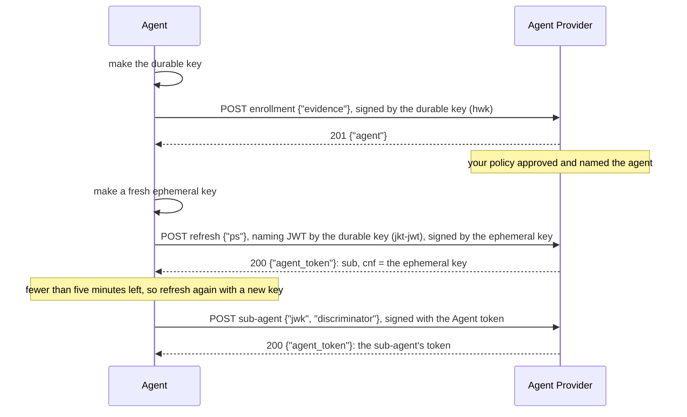

# Bootstrap

Bootstrap is how an agent comes to hold its Agent token. The agent makes a
key where it runs, shows its Agent Provider whatever the provider requires,
and receives a token whose `cnf.jwk` is that key and whose `sub` is an
identifier the provider chose. The draft also covers how the token is
refreshed, how a sub-agent gets its token, and how a self-hosted domain
issues tokens to its own agents.

An install has two keys:

- The **durable key** lives as long as the install, in a hardware keystore
  where the platform has one. It enrolls the install, and later signs only a
  short **naming JWT** at each refresh. It never signs requests to Person
  Servers, Access Servers or APIs.
- The **ephemeral key** is new at each refresh. Its public key is in the
  Agent token, and it signs the agent's requests until the next refresh.

The draft defines no endpoints, so you choose the URLs. Defined in
`draft-hardt-aauth-bootstrap`, which is informational. Terms are defined in
[How AAuth works](../how-aauth-works.md).

## Flow



## The code

From the end-to-end test
[`aauth-rust-agent-provider/tests/bootstrap.rs`](../../crates/aauth-rust-agent-provider/tests/bootstrap.rs).

Your policy decides each step. Here it names each install after its durable
key, grants hour-long tokens with the Person Server the agent asks for, and
allows two live sub-agents per parent:

<!-- sample: crates/aauth-rust-agent-provider/tests/bootstrap.rs -->
```rust ignore
struct Policy;
impl BootstrapPolicy for Policy {
    fn enroll(&self, request: &EnrollmentRequest<'_>) -> Result<EnrollmentApproval, Denial> {
        if request.evidence.get("blocked").is_some() {
            return Err(Denial::default());
        }
        Ok(EnrollmentApproval {
            local: thumbprint_local_part(request),
            account: Some("account-1".into()),
        })
    }
    fn refresh(&self, request: &RefreshRequest<'_>) -> Result<AgentGrant, Denial> {
        let grant = AgentGrant::new(3600);
        Ok(match request.ps {
            Some(ps) => grant.with_ps(ps),
            None => grant,
        })
    }
    fn subagent(&self, request: &SubagentRequest<'_>) -> Result<i64, Denial> {
        if request.live.len() >= 2 {
            return Err(Denial {
                reason: Some("two live sub-agents at most".into()),
            });
        }
        Ok(7200)
    }
}
```

`BootstrapService::new` takes the provider, the four URLs, a store and the
policy. `handle` answers one request at the URLs it serves; serve
`metadata()` and `jwks()` from `service.provider()` beside it.

The agent side is `BootstrapClient`, which holds the durable key. Your code
sends each request it builds and hands back the answer. A refresh makes a
fresh ephemeral key, and `complete_refresh` checks the new token under the
provider's published keys before it returns the `Agent` that signs with it:

<!-- sample: crates/aauth-rust-agent-provider/tests/bootstrap.rs -->
```rust ignore
    let first = client
        .refresh_request(&format!("{AP}/refresh"), Some(PS), &json!({}), NOW)
        .unwrap();
    let answer = service.handle(first.request(), NOW).into_response();
    assert_eq!(answer.headers()["cache-control"], "no-store");
    let replay = service.handle(first.request(), NOW).into_response();
    assert_eq!(replay.status(), 401, "a naming JWT names one refresh");
    let agent = client.complete_refresh(first, &answer, &keys, NOW).unwrap();
```

`client.needs_refresh(now)` is true when fewer than five minutes remain.
Each naming JWT carries a `jti` and works once: the replay above is refused.

A parent asks for a sub-agent's token with its own token and key. The
sub-agent made its key pair; only the public key travels:

<!-- sample: crates/aauth-rust-agent-provider/tests/bootstrap.rs -->
```rust ignore
    let child_key = SigningKey::from_seed([5; 32]);
    let request = parent
        .subagent_request(
            &format!("{AP}/subagent"),
            &child_key.public_jwk(),
            Some("search1"),
            NOW,
        )
        .unwrap();
    let child = issued_agent_token(&service.handle(&request, NOW).into_response()).unwrap();
    let verified = Subagent::verify(parent.token(), &child, &keys, NOW).unwrap();
```

The sub-agent's identifier is the parent's, `+` and the discriminator. Its
token copies the parent's Person Server and never outlives the parent's
token. A sub-agent cannot ask for sub-agents of its own.

## Self-hosted domains

A domain you run is its own Agent Provider. Its token-issuing process calls
`issue_to` for each agent, with the key that agent made where it runs. A
domain with a single agent can use the provider's own key,
`provider.public_jwk()`. Only the provider key is in `jwks()`:

<!-- sample: crates/aauth-rust-agent-provider/tests/bootstrap.rs -->
```rust ignore
    let planner = ap
        .issue_to(
            "aauth:planner@ap.example",
            &SigningKey::from_seed([2; 32]).public_jwk(),
            &AgentGrant::new(3600).with_ps(PS),
            NOW,
        )
        .unwrap();
    let researcher = ap
        .issue_to(
            "aauth:research@ap.example",
            &SigningKey::from_seed([3; 32]).public_jwk(),
            &AgentGrant::new(3600).with_ps(PS),
            NOW,
        )
        .unwrap();
```

`issue_subagent_to` issues a sub-agent's token under a parent token the same
domain issued. Re-issue a token whenever an agent's key changes; there is no
refresh ceremony.

## What your service supplies

- **Policy.** `BootstrapPolicy` approves each enrollment and names the agent,
  re-checks the install at each refresh, and decides sub-agents. Verify any
  platform attestation (App Attest, Play Integrity, WebAuthn) in `enroll`,
  bound to a single-use nonce you issued; the library checks none.
- **A durable store.** `BootstrapStore` keeps enrollments, used naming-JWT
  identifiers and the sub-agent tokens each parent requested.
  `MemoryBootstrapStore` loses them when the process exits.
- **Revocation.** `store.set_state(thumbprint, EnrollmentState::Revoked)`
  stops refreshes for an install. To end its current token, revoke it at the
  agent's Person Server.

The choices made where the draft leaves room are in
[INTERPRETATIONS.md](../../INTERPRETATIONS.md#selected-bootstrap-interpretations).
