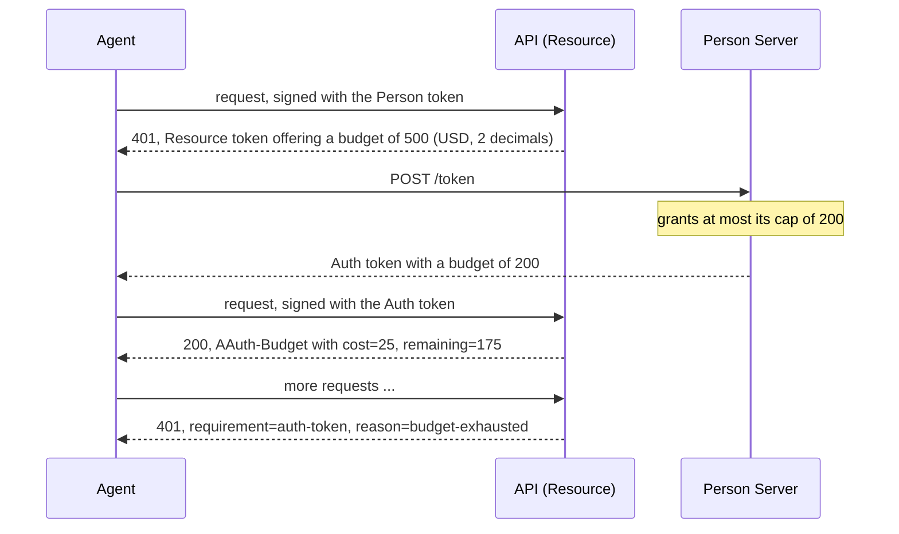

# Budgets

A **budget** caps what an agent may spend at one Resource. The Resource
declares a unit, such as US dollars at two decimals, and offers an amount in
its Resource token. The Person Server (or Access Server) grants an amount, no
more than the offer and no more than its own cap, as a `budget` claim in the
Auth token. The Resource counts each request against it, and reports what is
left in an `AAuth-Budget` response header. When the budget runs out, the
Resource asks for a new Auth token, and the Person Server decides again.

Defined in `draft-hardt-aauth-budgets`. Terms are defined in
[How AAuth works](../how-aauth-works.md).

## Flow



## Smallest working code

The three-party exchange from the [Person Server](../roles/person-server.md)
guide, with budgets turned on at both servers. The API charges at most 25
cents a request and offers $5.00; the Person Server grants at most $2.00.

```rust
use aauth_rust_agent::{Agent, Requirement};
use aauth_rust_agent_provider::AgentProvider;
use aauth_rust_budgets::{IssuerPolicy, UnitDeclaration};
use aauth_rust_core::{
    AgentClaims, AgentKeyResolver, Confirmation, TokenError, TrustedIssuerKeys, VerifiedAuthToken,
};
use aauth_rust_jose::{Jwk, SigningKey};
use aauth_rust_person_server::{
    AuthorizationRequest, Config, Grant, MemoryStore, Person, PersonRequest, PersonServer, Policy,
    PolicyError,
};
use aauth_rust_resource::{AuthDecision, PsAuthorizationConfig, PsAuthorizationResource};
use http::{Request, Response};
use serde_json::{Value, json};
use std::collections::BTreeMap;
use std::error::Error;
use std::sync::atomic::{AtomicU64, Ordering};
use std::sync::{Arc, RwLock};
use std::time::{SystemTime, UNIX_EPOCH};

const AP: &str = "https://ap.example";
const PS: &str = "https://ps.example";
const API: &str = "https://api.example";

struct People;
impl Policy for People {
    fn bind_person(&self, _: &PersonRequest) -> Result<Person, PolicyError> {
        Ok(Person {
            id: "person-1".into(),
            subject: "u-7f3c9a".into(),
            tenant: None,
        })
    }
    fn authorize(&self, request: &AuthorizationRequest) -> Result<Grant, PolicyError> {
        Ok(Grant {
            scopes: request.scopes.clone(),
            lifetime: 600,
        })
    }
}

/// The servers this deployment trusts, keyed by identifier and metadata document.
#[derive(Clone, Default)]
struct Trust(Arc<RwLock<BTreeMap<(String, String), TrustedIssuerKeys>>>);
impl Trust {
    fn add(
        &self,
        issuer: &str,
        dwk: &str,
        metadata: &[u8],
        jwks: &[u8],
    ) -> Result<(), Box<dyn Error>> {
        let keys = TrustedIssuerKeys::from_documents(issuer, dwk, metadata, jwks)?;
        self.0
            .write()
            .unwrap()
            .insert((issuer.into(), dwk.into()), keys);
        Ok(())
    }
}
impl AgentKeyResolver for Trust {
    fn key(&self, issuer: &str, dwk: &str, kid: &str) -> Result<Jwk, TokenError> {
        let trusted = self.0.read().map_err(|_| TokenError::InvalidKey)?;
        let keys = trusted
            .get(&(issuer.into(), dwk.into()))
            .ok_or(TokenError::UntrustedIssuer)?;
        keys.key(issuer, dwk, kid)
    }
}

fn now() -> i64 {
    SystemTime::now()
        .duration_since(UNIX_EPOCH)
        .unwrap()
        .as_secs() as i64
}

fn get(uri: &str) -> Result<Request<Vec<u8>>, Box<dyn Error>> {
    Ok(Request::builder().uri(uri).body(Vec::new())?)
}

fn post(agent: &Agent, uri: &str, body: Value) -> Result<Request<Vec<u8>>, Box<dyn Error>> {
    let mut request = Request::builder()
        .method("POST")
        .uri(uri)
        .header("content-type", "application/json")
        .body(serde_json::to_vec(&body)?)?;
    agent.sign(&mut request, now())?;
    Ok(request)
}

fn token(response: Response<Vec<u8>>, name: &str) -> Result<String, Box<dyn Error>> {
    if response.status() != 200 {
        return Err(format!("refused: {}", String::from_utf8_lossy(response.body())).into());
    }
    let body: Value = serde_json::from_slice(response.body())?;
    Ok(body[name]
        .as_str()
        .ok_or("no token in the response")?
        .to_owned())
}

fn main() -> Result<(), Box<dyn Error>> {
    let trust = Trust::default();
    let provider = AgentProvider::new(AP, "ap-1", SigningKey::generate())?;
    trust.add(
        AP,
        "aauth-agent.json",
        &provider.metadata()?,
        &provider.jwks()?,
    )?;
    let key = SigningKey::generate();
    let agent_token = provider.issue(&AgentClaims {
        iss: AP.into(),
        dwk: "aauth-agent.json".into(),
        sub: "aauth:assistant@ap.example".into(),
        jti: "assistant-1".into(),
        iat: now(),
        exp: now() + 3600,
        cnf: Confirmation {
            jwk: key.public_jwk(),
        },
        ps: Some(PS.into()),
        parent_agent: None,
        nbf: None,
        extra: Default::default(),
    })?;
    let agent = Agent::new(key, agent_token)?;

    // The Person Server grants at most 200 cents on one Auth token.
    let ids = AtomicU64::new(0);
    let ps = PersonServer::new(
        Config::new(PS, "ps-1", SigningKey::generate()),
        trust.clone(),
        MemoryStore::default(),
        People,
        now,
        move || format!("ps-{}", ids.fetch_add(1, Ordering::SeqCst)),
    )?
    .with_budgets(IssuerPolicy::capped(200, Vec::new()))?;
    let metadata = ps.handle(&get(&format!("{PS}/.well-known/aauth-person.json"))?);
    let jwks = ps.handle(&get(&format!("{PS}/.well-known/jwks.json"))?);
    trust.add(PS, "aauth-person.json", metadata.body(), jwks.body())?;

    // The API meters in US dollars at two decimals. A request costs at most 25,
    // and a challenge offers 500 when the agent names no amount.
    let api = PsAuthorizationResource::new(
        PsAuthorizationConfig {
            issuer: API.into(),
            signed_origin: API.into(),
            kid: "api-1".into(),
            signing_key: SigningKey::generate(),
            scopes: vec!["search".into()],
            scope_descriptions: BTreeMap::from([("search".into(), "Run paid searches".into())]),
        },
        trust.clone(),
        |_: &VerifiedAuthToken, _: &Request<Vec<u8>>| true,
    )?
    .with_budgets(
        vec![UnitDeclaration::new("USD", 2, "US dollars")?],
        format!("{API}/usage"),
        25,
        500,
    )?;
    trust.add(API, "aauth-resource.json", &api.metadata()?, &api.jwks()?)?;

    // Person token, challenge, exchange: as in the Person Server guide.
    let person = token(
        ps.handle(&post(
            &agent,
            &format!("{PS}/person"),
            json!({"resource": API}),
        )?),
        "person_token",
    )?;
    let mut call = get(&format!("{API}/search"))?;
    agent.with_token(person.clone())?.sign(&mut call, now())?;
    let challenge = api.authorize(&call, now(), "challenge-1").into_response();
    let Some(Requirement::AuthToken { resource_token }) =
        Requirement::from_headers(challenge.headers())?
    else {
        return Err("expected an auth-token requirement".into());
    };
    let resource =
        agent.verify_resource_challenge(&resource_token, API, PS, &person, &trust, now())?;
    let exchange = json!({"resource_token": resource_token, "presented_token": person});
    let auth = token(
        ps.handle(&post(&agent, &format!("{PS}/token"), exchange)?),
        "auth_token",
    )?;
    agent.verify_auth_delivery(&auth, API, &resource, &person, &trust, now())?;

    // Each admitted request is charged, and the answer says what is left.
    let mut call = get(&format!("{API}/search"))?;
    agent.with_token(auth)?.sign(&mut call, now())?;
    let AuthDecision::Granted(admitted) = api.authorize(&call, now(), "challenge-2") else {
        return Err("expected the API to admit the request".into());
    };
    let header = admitted.budget_header().ok_or("no AAuth-Budget")?;
    assert!(header.contains("cost=25"), "{header}");
    assert!(header.contains("remaining=175"), "{header}");
    Ok(())
}
```

`budget_header()` is the value to send as `AAuth-Budget` on your response;
`into_response()` sends it for you.

## Turning it on

- **Resource:** `PsAuthorizationResource::with_budgets(units, usage_endpoint,
  default_bound, default_offer)`. `units` are the units you meter in, with
  their decimals; the first is the one you offer. `default_bound` is the most
  one request may cost: the library reserves it before your handler runs and
  charges it when the request is admitted. An agent can lower it for one
  request with an `AAuth-Max-Cost` header, never raise it. `default_offer` is
  the amount your challenge offers when the agent asks for none.
- **Person Server:** `PersonServer::with_budgets(IssuerPolicy)`.
  `IssuerPolicy::capped(cap, units)` grants at most `cap`. The Person Server
  also keeps the total of its outstanding grants for a person at a Resource
  within the cap.
- **Access Server:** `AccessServer::with_budgets(IssuerPolicy)`, in four-party
  access.

## When the budget runs out

A request that does not fit is refused without being charged, with a `401`
and `requirement=auth-token`: `reason=budget-exhausted` when nothing is left,
`reason=insufficient-budget` when something is left but not enough, with the
amount it needed in `required`. The agent takes the new Resource token to its
Person Server, as for any Auth token. `AAuth-Budget` is sent on refusals too.

## More control

- To charge the actual cost after the work, rather than a fixed bound, use
  `authorize_reserved`, then `budget_commit` or `budget_release`. For a
  streamed response, `budget_stream_header` and `budget_trailer` report the
  cost at the end.
- `usage()` answers the Person Server's or Access Server's query at your
  `usage_endpoint`; they build the query with `usage_request` and read it with
  `read_usage`. See [Read usage counters](../../USE-IN-YOUR-SERVICE.md#read-usage-counters).
- Budgets compose with [R3](r3.md): a class document's Resource token can
  offer a budget, and so can a per-call proposal whose release you meter. The
  Person Server grants it on the Auth token, or in four-party access sends its
  ceiling to the Access Server and releases only a token whose budget is
  within it. The agent's `verify_r3_auth_delivery` and
  `verify_r3_per_call_delivery` refuse a granted budget in another unit or
  scale, or above the offer.
- By default the meter is in memory. `with_budget_ledger` with
  `aauth_rust_budgets::Ledger::open_directory` keeps it in a directory, so
  that a restart does not forget what was spent.
- `aauth-rust-budgets` has the agent-side helpers: `read_granted` reads the
  budget an Auth token grants, and `parse_header` with `act_on_header` reads
  the remaining balance from an `AAuth-Budget` header, ignoring a stale one or
  one whose unit disagrees with the token.

## Limits

- The library implements the budget object, offers, narrowing, issuance at the
  Person Server and Access Server, metering, refusals and usage counters, not
  the whole draft. The conformance suite's budget scenarios
  ([73-78](https://gitlab.com/sidecat-dev/aauth-conformance/-/tree/dbf640d/scenarios)) grade it, and
  [INTERPRETATIONS.md](../../INTERPRETATIONS.md) ("Selected budget
  interpretations") records the choices, for example how the client's maximum
  cost header is spelled.
- A server without `with_budgets` refuses a token that carries a budget.

## Next

- The budget tests:
  [`aauth-rust-resource/tests/budgets.rs`](../../crates/aauth-rust-resource/tests/budgets.rs).
