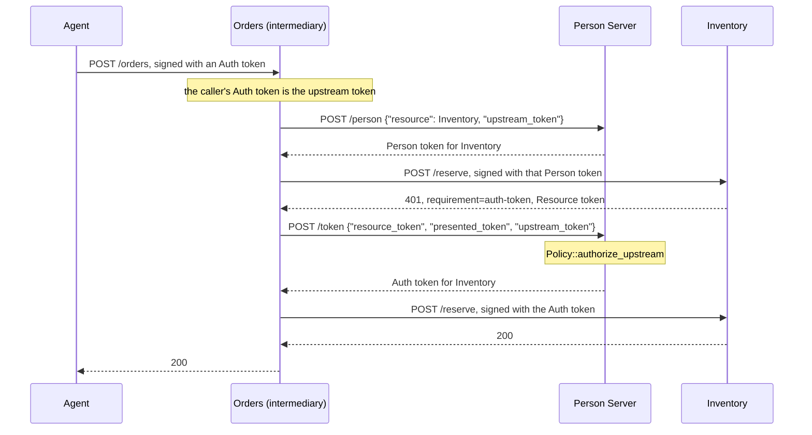

# Call chaining

Call chaining lets an API call another API for the same person. The first API,
the **intermediary**, received an authorized request from an agent. To serve
it, the intermediary acts as an agent itself and gets its own Person and Auth
tokens for the downstream API, presenting the caller's token as evidence of who
it acts for. The person's Person Server decides each hop.

Defined in the core protocol draft, section "Call Chaining". Terms are defined
in [How AAuth works](../how-aauth-works.md).

## Flow



The intermediary signs every downstream request with its own key and its own
Agent token. The **upstream token** is the token the agent presented to the
intermediary; it travels only as a parameter in the JSON body.

## Run it

```sh
cargo run --locked -p aauth-rust-resource --example three-party
```

The example runs an Agent Provider, a Person Server, Orders and Inventory over
TLS on loopback ports. Its output includes
`directed-subjects-differ=true downstream-within-upstream=true
intermediary-binding=false`: Inventory sees a different identifier for the
person than Orders does, the downstream token expires no later than the
upstream one, and the Person Server binds no person to the intermediary.

## The code

The intermediary is its own Agent Provider: its Agent token's issuer is its
own origin. It publishes `/.well-known/aauth-agent.json` there, with the same
issuer as its Resource metadata, so that the Person Server can tell it is the
party the upstream token was presented to.

<!-- sample: crates/aauth-rust-resource/examples/three_party/mod.rs -->
```rust ignore
    let intermediary_ap = Arc::new(AgentProvider::new(
        ORDERS,
        "orders-agent-1",
        SigningKey::generate(),
    )?);
    let intermediary = enrolled(
        &intermediary_ap,
        ORDERS,
        "aauth:orders@orders.example",
        "https://intermediary-person.example",
        "intermediary-1",
    )?;
```

Orders calls `downstream` from its handler, only after its own check admitted
the agent's Auth token, and passes that token's exact bytes as `upstream`:

<!-- sample: crates/aauth-rust-resource/examples/three_party/mod.rs -->
```rust ignore
fn downstream(
    agent: &Agent,
    ps: &TlsServer,
    inventory: &TlsServer,
    trust: &Trust,
    upstream: &str,
) -> Result<(Value, VerifiedAuthToken)> {
    let person = token_from(
        &successful(ps.send(&signed(
            agent,
            &format!("{PS}/person"),
            json!({"resource":INVENTORY,"upstream_token":upstream}),
        )?)?)?,
        "person_token",
    )?;
    let holder = agent.with_token(person.clone())?;
    let request = signed(
        &holder,
        &format!("{INVENTORY}/reserve"),
        json!({"item":"tree","quantity":2}),
    )?;
    let challenge = inventory.send(&request)?;
    let resource = resource_challenge(&challenge)?;
    let verified =
        agent.verify_resource_challenge(&resource, INVENTORY, PS, &person, trust, now())?;
    let auth = token_from(
        &successful(ps.send(&signed(
            agent,
            &format!("{PS}/token"),
            json!({"resource_token":resource,"presented_token":person,"upstream_token":upstream}),
        )?)?)?,
        "auth_token",
    )?;
    let verified_auth =
        agent.verify_auth_delivery(&auth, INVENTORY, &verified, &person, trust, now())?;
    let holder = agent.with_token(auth)?;
    let response = inventory.send(&signed(
        &holder,
        &format!("{INVENTORY}/reserve"),
        json!({"item":"tree","quantity":2}),
    )?)?;
    Ok((successful(response)?, verified_auth))
}
```

The Person Server decides each downstream hop with two policy methods. Both
refuse unless you implement them:

<!-- sample: crates/aauth-rust-resource/examples/three_party/mod.rs -->
```rust ignore
    fn bind_upstream(&self, request: &PersonRequest) -> std::result::Result<Person, PolicyError> {
        let upstream = request.upstream.as_ref().ok_or(PolicyError::Denied)?;
        if request.resource != INVENTORY
            || upstream.record.resource != ORDERS
            || upstream.record.person_id != "host-internal-person"
        {
            return Err(PolicyError::Denied);
        }
        directed(&request.resource)
    }
    fn authorize_upstream(
        &self,
        request: &AuthorizationRequest,
    ) -> std::result::Result<Grant, PolicyError> {
        let upstream = request.upstream.as_ref().ok_or(PolicyError::Denied)?;
        if request.resource.claims().iss != INVENTORY
            || request.scopes != ["inventory.reserve"]
            || upstream.scope.as_deref() != Some("orders.write")
        {
            return Err(PolicyError::Denied);
        }
        Ok(Grant {
            scopes: request.scopes.clone(),
            lifetime: 600,
        })
    }
```

`request.upstream` holds the Person Server's record of the upstream token: the
Resource it was issued for, the person, and its scope. Downstream scopes need
not be a subset of upstream scopes; your policy decides.

## Rules the library enforces

- The downstream Person and Auth tokens expire no later than the upstream
  token.
- The Person Server accepts an upstream token only if it issued it, or its own
  Access Server did, and holds its record. It refuses the chain with
  `revoked_upstream_token` once it has revoked that token, the calling agent's
  Agent token, or the agent's binding to the person.
- The downstream identifier for the person comes from the Person Server's
  policy, never copied from the upstream token. A policy that returns the
  upstream subject is refused with `403 access_denied`.
- No person is bound to the intermediary.
- When the upstream token carries a mission, the downstream tokens carry the
  same mission and expire no later than it; see
  [Missions](missions.md).
- With an Access Server, the Person Server passes `upstream_token` on, and
  `Policy::consent_upstream` decides for the person. It also refuses unless you
  implement it.

## What your service supplies

- **Routing.** Send the downstream token requests to the Person Server the
  upstream token names: the `iss` of a Person token, the `ps` of an Auth token.
  Never the `ps` in the intermediary's own Agent token.
- **Only served requests.** Start a chain only from a request you served. A
  Person token you answered with an auth-token challenge is not upstream
  evidence.
- **Repeats.** Replaying the same signed request to the intermediary starts the
  whole chain again: new tokens, a second downstream call, a second effect.
  Make the operation idempotent before you ask for downstream tokens.
- **Interaction.** When a downstream server needs the person
  (`requirement=interaction`), the intermediary answers its own caller with
  its own `202`, code and pending URL. `ChainedInteraction` in
  `aauth_rust_core::interaction` does this.

## Next

- [Make an immediate downstream call](../../USE-IN-YOUR-SERVICE.md#make-an-immediate-downstream-call):
  the full reference.
- [Person Server](../roles/person-server.md): the exchange each hop repeats.
