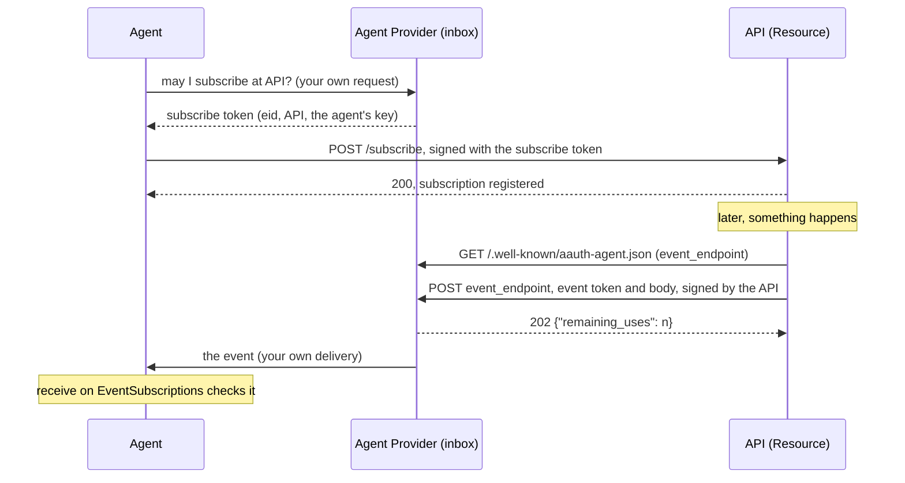

# Events

AAuth Events lets an API notify an agent later, when something changes: a
waitlist slot opens, an order ships. Agents usually cannot receive incoming
connections, so the API does not call the agent. It sends the event to the
agent's Agent Provider, which acts as the agent's inbox and passes it on.

Three tokens make this safe:

- A **subscribe token**, signed by the Agent Provider, lets one Resource send
  events to one agent. It names the subscription with an event ID, `eid`.
- The agent registers the subscription at the Resource, signing the
  registration request with the subscribe token in place of its Agent token.
- Each **event token**, signed by the Resource, names the subscription and
  carries a hash of the event body. The Agent Provider and the agent check it
  with the Resource's published key.

Defined in `draft-hardt-aauth-events`. Terms are defined in
[How AAuth works](../how-aauth-works.md).

## Flow



## The code

From the end-to-end test
[`aauth-rust-resource/tests/events.rs`](../../crates/aauth-rust-resource/tests/events.rs):
the Agent Provider issues a subscribe token, the agent registers it, the
Resource delivers an event with a body, and the agent checks it.

<!-- sample: crates/aauth-rust-resource/tests/events.rs -->
```rust ignore
    // The AP issues and retains; the Agent records its context and registers.
    let token = subscribe_token(&ap, inbox.store(), Some(2));
    let mut contexts = EventSubscriptions::new(AGENT).unwrap();
    let eid = contexts.remember(&token, "waitlist for Dr. Smith").unwrap();
    let mut request = registration("/appointments/waitlist");
    agent.sign_subscription(&mut request, &token, 1000).unwrap();
    assert_eq!(
        resource
            .register(&request, 1000, allow)
            .into_response()
            .status(),
        200
    );

    // An event with a body: 202 with remaining_uses, then the Agent verifies
    // the exact bytes the Agent Provider recorded.
    let first = resource
        .prepare_event(
            "https://ap.example",
            &eid,
            Some(EventPayload {
                content_type: "application/json",
                body: PAYLOAD,
            }),
            1300,
            1000,
        )
        .unwrap();
    let third = resource
        .prepare_event("https://ap.example", &eid, None, 1300, 1000)
        .unwrap();
    let delivered = resource
        .delivery_request(&first, &ap.metadata().unwrap(), 1000)
        .unwrap();
    let response = inbox.receive(&delivered, 1000).into_response();
    assert_eq!(response.status(), 202);
    assert_eq!(
        resource.delivery_outcome(&first, &response).unwrap(),
        DeliveryOutcome::Accepted {
            remaining_uses: Some(1)
        }
    );
    let pending = inbox.store().pending(AGENT).unwrap();
    assert_eq!(pending.len(), 1);
    assert_eq!(pending[0].event_token, first.token());
    assert_eq!(pending[0].body, PAYLOAD);
    let agent_keys = resource_keys(RESOURCE, &resource.jwks().unwrap());
    let received = contexts
        .receive(&pending[0].event_token, &pending[0].body, &agent_keys, 1001)
        .unwrap();
    assert_eq!(*received.context, "waitlist for Dr. Smith");
```

## Each role

**Agent Provider** (`aauth_rust_agent_provider`):

- `AgentProvider::with_event_endpoint(url)` publishes `event_endpoint` in the
  provider's metadata.
- `issue_subscribe_token(store, &SubscribeRequest { .. }, now)` issues a
  subscribe token for one agent at one Resource, after your service decided
  the agent may subscribe. It checks the agent's current Agent token and
  copies its key, and stores the subscription before returning the token.
- `events::EventInbox::new(&provider, resource_keys, store)` receives
  deliveries: route `POST` requests for the event endpoint to
  `inbox.receive(&request, now).into_response()`. It answers `202` once the
  event is stored, drops a repeated event, and refuses events from another
  Resource or for an ended subscription.
- `DirectoryEventStore::open(directory)` stores subscriptions and events on
  disk; `MemoryEventStore` is for tests. Hand the agent what
  `store.pending(agent)` returns, unchanged, by whatever channel you have
  with it, and `acknowledge` each event once delivered.

**Agent** (`aauth_rust_agent`):

- `EventSubscriptions::new(agent_identifier)`, then `remember(&token,
  context)` before registering, to record what the subscription is for.
- `agent.sign_subscription(&mut request, &token, now)` signs the registration.
- `subscriptions.receive(&event_token, &body, &resource_keys, now)` checks a
  delivered event: the Resource's signature, that it is for this agent, the
  body hash, the subscription and its Resource, and that the event has not
  been seen before. Act only on `Ok`. The record of events already seen is
  in memory; keep your own if the agent must not act twice across restarts.

**Resource** (`aauth_rust_resource::events`):

- `EventsResource::new(EventsConfig { .. }, ap_keys, store)`. Publish its
  `jwks()`, and name them as `jwks_uri` in your Resource metadata.
- `register(&request, now, policy)` registers a public subscription; your
  policy decides, and returns the context to keep.
- For a subscription that only a known person may open, `issue_ticket` after
  an authenticated request, and route registrations under `ticket_path` to
  `register_with_ticket`. The ticket is single use and bound to the key of the
  agent that obtained it.
- To deliver: `prepare_event(agent_provider, eid, payload, expires_at, now)`,
  then fetch `agent_provider_metadata_url(agent_provider)`, then
  `delivery_request(&event, &metadata, now)`, which signs the `POST` to the
  provider's current `event_endpoint`. Send it, following no redirects, and
  pass the answer to `delivery_outcome`. To retry, sign the same prepared
  event again: the provider drops the duplicate.
- `with_asyncapi(document)` publishes an AsyncAPI description of your event
  channels.

No role opens a connection: your service fetches metadata, applies its own
limits on where it connects, and sends.

## Limits

- AsyncAPI payloads are not validated.
- The directory stores keep accepted events and have no compaction; a long
  subscription's file grows with every event.
- How the Agent Provider passes events on to the agent is up to you, as the
  draft leaves it.

## Next

- [Subscribe to and deliver AAuth Events](../../USE-IN-YOUR-SERVICE.md#subscribe-to-and-deliver-aauth-events):
  the full reference.
