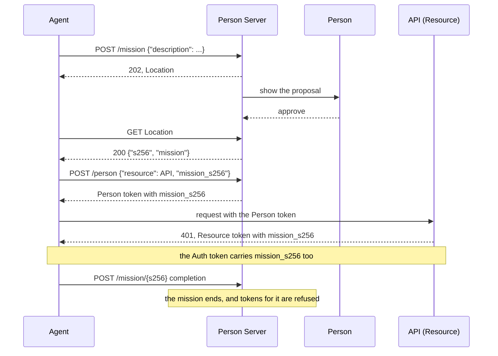

# Missions

A **mission** is a description of what an agent intends to do, which the agent
proposes and the person approves at their Person Server. While the mission
lasts, every token the agent obtains under it carries the mission's identifier,
`mission_s256`: the SHA-256 hash of the approved mission document. The Person
Server checks each request against the mission, and a Resource can see which
mission a request belongs to. When the mission ends, the Person Server refuses
further tokens for it.

Defined in the core protocol draft, section "Mission". Terms are defined in
[How AAuth works](../how-aauth-works.md).

## Flow



## Smallest working code

The Person Server issues tokens under a mission when its store holds an
approved mission record. Here your service installs one, as it would after the
person approved, the agent gets a Person token under it, and then the mission
is ended.

```rust
use aauth_rust_agent::Agent;
use aauth_rust_agent_provider::AgentProvider;
use aauth_rust_core::{
    AgentClaims, AgentKeyResolver, ApprovedMission, Confirmation, PersonToken, TokenError,
    TrustedIssuerKeys,
};
use aauth_rust_jose::{Jwk, SigningKey};
use aauth_rust_person_server::{
    AgentIdentity, AuthorizationRequest, Config, Grant, MemoryStore, MissionRecord, MissionState,
    Person, PersonRequest, PersonServer, Policy, PolicyError,
};
use http::{Request, Response};
use serde_json::{Value, json};
use std::collections::BTreeMap;
use std::error::Error;
use std::sync::atomic::{AtomicU64, Ordering};
use std::sync::{Arc, RwLock};
use std::time::{SystemTime, UNIX_EPOCH};

const AP: &str = "https://ap.example";
const PS: &str = "https://ps.example";
const API: &str = "https://api.example";

struct People;
impl Policy for People {
    fn bind_person(&self, _: &PersonRequest) -> Result<Person, PolicyError> {
        // Under a mission, the person must be the one who approved it.
        Ok(Person {
            id: "person-1".into(),
            subject: "u-7f3c9a".into(),
            tenant: None,
        })
    }
    fn authorize(&self, _: &AuthorizationRequest) -> Result<Grant, PolicyError> {
        Err(PolicyError::Denied)
    }
}

/// The servers this deployment trusts, keyed by identifier and metadata document.
#[derive(Clone, Default)]
struct Trust(Arc<RwLock<BTreeMap<(String, String), TrustedIssuerKeys>>>);
impl Trust {
    fn add(
        &self,
        issuer: &str,
        dwk: &str,
        metadata: &[u8],
        jwks: &[u8],
    ) -> Result<(), Box<dyn Error>> {
        let keys = TrustedIssuerKeys::from_documents(issuer, dwk, metadata, jwks)?;
        self.0
            .write()
            .unwrap()
            .insert((issuer.into(), dwk.into()), keys);
        Ok(())
    }
}
impl AgentKeyResolver for Trust {
    fn key(&self, issuer: &str, dwk: &str, kid: &str) -> Result<Jwk, TokenError> {
        let trusted = self.0.read().map_err(|_| TokenError::InvalidKey)?;
        let keys = trusted
            .get(&(issuer.into(), dwk.into()))
            .ok_or(TokenError::UntrustedIssuer)?;
        keys.key(issuer, dwk, kid)
    }
}

fn now() -> i64 {
    SystemTime::now()
        .duration_since(UNIX_EPOCH)
        .unwrap()
        .as_secs() as i64
}

fn get(uri: &str) -> Result<Request<Vec<u8>>, Box<dyn Error>> {
    Ok(Request::builder().uri(uri).body(Vec::new())?)
}

/// The agent's signed request for a Person token for the API, under a mission.
fn person_request(agent: &Agent, mission_s256: &str) -> Result<Request<Vec<u8>>, Box<dyn Error>> {
    let body = json!({"resource": API, "mission_s256": mission_s256});
    let mut request = Request::builder()
        .method("POST")
        .uri(format!("{PS}/person"))
        .header("content-type", "application/json")
        .body(serde_json::to_vec(&body)?)?;
    agent.sign(&mut request, now())?;
    Ok(request)
}

fn token(response: Response<Vec<u8>>, name: &str) -> Result<String, Box<dyn Error>> {
    if response.status() != 200 {
        return Err(format!("refused: {}", String::from_utf8_lossy(response.body())).into());
    }
    let body: Value = serde_json::from_slice(response.body())?;
    Ok(body[name]
        .as_str()
        .ok_or("no token in the response")?
        .to_owned())
}

fn main() -> Result<(), Box<dyn Error>> {
    let trust = Trust::default();
    let provider = AgentProvider::new(AP, "ap-1", SigningKey::generate())?;
    trust.add(
        AP,
        "aauth-agent.json",
        &provider.metadata()?,
        &provider.jwks()?,
    )?;
    let key = SigningKey::generate();
    let agent_token = provider.issue(&AgentClaims {
        iss: AP.into(),
        dwk: "aauth-agent.json".into(),
        sub: "aauth:assistant@ap.example".into(),
        jti: "assistant-1".into(),
        iat: now(),
        exp: now() + 3600,
        cnf: Confirmation {
            jwk: key.public_jwk(),
        },
        ps: Some(PS.into()),
        parent_agent: None,
        nbf: None,
        extra: Default::default(),
    })?;
    let agent = Agent::new(key, agent_token)?;

    // MemoryStore clones share one store: the host keeps one, the server the other.
    let store = MemoryStore::default();
    let ids = AtomicU64::new(0);
    let ps = PersonServer::new(
        Config::new(PS, "ps-1", SigningKey::generate()),
        trust.clone(),
        store.clone(),
        People,
        now,
        move || format!("ps-{}", ids.fetch_add(1, Ordering::SeqCst)),
    )?;
    let metadata = ps.handle(&get(&format!("{PS}/.well-known/aauth-person.json"))?);
    let jwks = ps.handle(&get(&format!("{PS}/.well-known/jwks.json"))?);
    trust.add(PS, "aauth-person.json", metadata.body(), jwks.body())?;

    // The person approved this mission. The host records it for issuance.
    let mission = ApprovedMission::mint(
        "aauth:assistant@ap.example",
        now(),
        "Plan the team offsite: read calendars and draft an agenda.",
    )?;
    let owner = AgentIdentity {
        issuer: AP.into(),
        subject: "aauth:assistant@ap.example".into(),
    };
    store.install_approved_mission(MissionRecord {
        person_server: PS.into(),
        owner: owner.clone(),
        person_id: "person-1".into(),
        document: mission.clone(),
        state: MissionState::Active,
    })?;

    // The agent names the mission, and its Person token carries it.
    let person = token(
        ps.handle(&person_request(&agent, mission.s256())?),
        "person_token",
    )?;
    let claims = PersonToken::parse(&person)?
        .verify(&trust, now())?
        .claims()
        .clone();
    assert_eq!(claims.mission_s256.as_deref(), Some(mission.s256()));

    // Once the mission ends, the Person Server refuses it, and the agent records that.
    store.terminate_mission(PS, &owner, mission.s256(), "completed")?;
    let refused = ps.handle(&person_request(&agent, mission.s256())?);
    assert_eq!(refused.status(), 403);
    assert!(agent.missions().observe(mission.s256(), &refused).is_some());
    assert!(!agent.missions().is_active(mission.s256()));
    Ok(())
}
```

## Proposing and approving

`PersonServer::with_missions()` adds the mission endpoint, `/mission`, and
names it in the metadata as `mission_endpoint`:

1. The agent proposes with a signed `POST /mission` carrying a `description`.
   The answer is `202` with a `Location` for the proposal.
2. The person approves on your consent screen. Your service then sends the
   approval: a `POST` to `{Location}/approval`, signed with the Person Server's
   own key, with `{"decision":"approve"}` or `{"decision":"deny"}`. Without
   that signature the proposal stays pending. If the person set an end date,
   add it as `expires_at`, an RFC 3339 time such as `"2026-12-01T00:00:00Z"`:
   the mission document carries it, and after it the mission is terminated.
3. The agent polls `Location` once and receives `s256` and the mission
   document. A denied proposal answers `403 access_denied`.
4. The agent reports progress with an update, and finishes with a completion,
   at `/mission/{s256}`.

The approved documents are written with `Store::write_mission_audit`.
Issuance under a mission reads a separate `MissionRecord` from the store, which
your service installs, as above, with `MemoryStore::install_approved_mission`.
Proposals are held in memory.

`with_governance(governance)` adds the permission and audit endpoints: the
agent asks the person's permission for an action (`Agent::post_permission`)
and records what it did (`Agent::post_audit`). Your `Governance` decides
permissions. An `interaction` or `payment` the agent asks you to relay goes
to your `RelayChannel` with `with_interaction_relay`; without one it answers
`424 interaction_unavailable`, and the agent directs the person itself.

## Issuing under a mission

- The agent sends `mission_s256` with `POST /person`. `Policy::bind_person`
  receives the verified mission in `request.mission`, and must return the
  person who approved it.
- Person and Auth tokens carry `mission_s256` and expire no later than the
  mission's `expires_at`.
- A Resource accepts mission-bearing tokens only after
  `PsAuthorizationResource::with_mission_context()`. It then copies the
  mission into its Resource token, and your Resource policy sees the Auth
  token's `mission_s256` and must compare it with the mission it expects.
  Without it, the Resource refuses a mission-bearing token before your policy.
- Missions travel down call chains and through an Access Server: the
  downstream tokens carry the caller's mission.
- An ended or expired mission is refused with `403 mission_terminated`. Pass
  the answer to `agent.missions().observe(s256, &response)`; afterwards
  `agent.missions().is_active(s256)` is false, and
  `agent.missions().may_present(token)` tells you whether a token is still
  usable.

## Limits

- Missions with sub-agents, and with R3 per-call proposals, are refused. Mission
  context does not combine with R3 behind an Access Server.
- An Auth token already issued stays valid at the Resource until it expires
  when the mission ends; the library sends no notice to Resources.
- The redb store does not support missions.
- A mission store of your own must check the mission and store the token in
  one atomic step.

## Next

- [Stop acting on a terminated mission](../../USE-IN-YOUR-SERVICE.md#stop-acting-on-a-terminated-mission),
  and the mission tests in
  [`tests/missions.rs`](../../crates/aauth-rust-person-server/tests/missions.rs)
  and [`tests/mission_endpoint.rs`](../../crates/aauth-rust-person-server/tests/mission_endpoint.rs).
- [Supervision](supervision.md): a supervision server can approve missions in
  the person's place.
