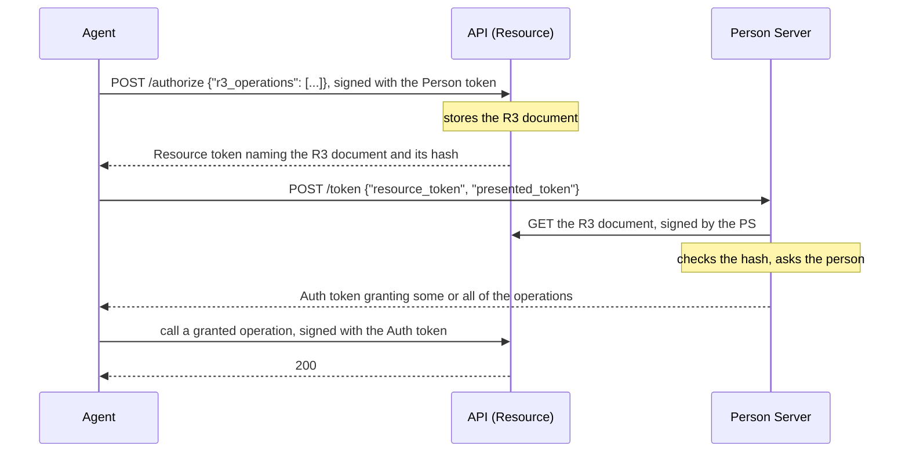

# R3: Rich Resource Requests

A scope such as `records.write` says little to the person approving it, and
nothing about which operations it covers. **R3** lets a Resource describe its
operations in a vocabulary the agent already uses, such as MCP tools or
OpenAPI operations, and lets the person approve specific ones:

- The Resource publishes an **R3 document**: the operations requested, and a
  description for the person. It is identified by its hash, so the record of
  what was approved cannot change afterwards.
- The Auth token grants **operations**, not just scopes, and the Resource
  admits a call only if its operation was granted.
- For one consequential call, the Resource can issue a **per-call proposal**:
  an R3 document for that call alone, with its parameters and what it will do,
  which the person approves or refuses before it runs.

Defined in `draft-hardt-aauth-r3`. Terms are defined in
[How AAuth works](../how-aauth-works.md).

## Flow



A per-call proposal adds a step: when the agent calls an operation listed for
per-call approval, the Resource answers `401` with a Resource token for a
proposal document describing that one call. The agent exchanges it as above,
and presents the per-call Auth token to run the call.

## Run it

```sh
cargo run --locked -p aauth-rust-resource --example r3-three-party
cargo run --locked -p aauth-rust-resource --example r3-per-call
cargo run --locked -p aauth-rust-r3 --example r3-definition
```

`r3-three-party` runs the flow above over TLS: the agent asks for
`records.read` and `records.export`, and the person grants one. `r3-per-call`
runs per-call proposals and held results. `r3-definition` parses an MCP tool
list into the operations a Resource would publish.

## The code

The agent's side, from the `r3-three-party` example: ask the Resource for a
Resource token for two operations, check it, exchange it, and check what was
granted.

<!-- sample: crates/aauth-rust-resource/examples/r3_three_party/mod.rs -->
```rust ignore
    let operations = mcp_operations(&["records.read", "records.export"])?;
    let resource_token = agent.r3_authorize(
        |request| api_tls.send(&request),
        &endpoint,
        &person,
        &operations,
        None,
        now(),
    )?;
    let verified_resource = agent.verify_r3_resource_token(
        &resource_token,
        RECORDS,
        PS,
        &person,
        None,
        &trust,
        now(),
    )?;
    let r3_uri = verified_resource.reference().uri().to_owned();

    // Agents are not entitled to the document, signed or not.
    let mut agent_fetch = get(&r3_uri)?;
    agent
        .with_token(person.clone())?
        .sign(&mut agent_fetch, now())?;
    let agent_fetch_status = api_tls.send(&agent_fetch)?.status().as_u16();
    let unsigned_fetch_status = api_tls.send(&get(&r3_uri)?)?.status().as_u16();

    // PS: literal fetch, consent to a narrower grant, audit, commit, release.
    let auth = token_from(
        ps_tls.send(&signed(
            &agent,
            &format!("{PS}/token"),
            &serde_json::to_vec(&json!({
                "resource_token": resource_token,
                "presented_token": person,
            }))?,
        )?)?,
        "auth_token",
    )?;
    let verified_auth = agent.verify_r3_auth_delivery(
        &auth,
        RECORDS,
        &verified_resource,
        &person,
        &registry,
        &trust,
        now(),
    )?;
```

## Turning it on

- **Resource:** `PsAuthorizationResource::with_r3(R3Config { .. })` with the
  vocabularies you serve, each built from your API definition (an MCP tool
  list, an OpenAPI or AsyncAPI document, a gRPC descriptor set, WSDL 1.1 or
  OData CSDL 4.0), the description shown to the person, and a store for R3
  documents. `DirectoryDocumentStore` keeps them on disk. Add
  `with_authorization_endpoint()` so that agents can ask for a Resource token
  for named operations. `R3Definitions` groups operations that have their own
  descriptions.
- **Per-call proposals:** `with_r3_per_call(R3PerCallConfig { .. })` lists the
  operations that need approval call by call, and a store for the calls
  (`DirectoryCallStore` keeps them on disk).
- **Held results:** for a query that changes nothing, set
  `R3PerCallConfig::hold` and `release`: the Resource runs it, holds the
  result, and releases it only when the person approves. With
  `with_release_metering`, the release is charged against a
  [budget](budgets.md).
- **Person Server:** `PersonServer::with_r3(R3IssuerConfig { .. })`, with the
  transport it fetches R3 documents with, a check on which URLs it may fetch,
  and an `R3Policy` that decides. `authorize_proposal` and
  `authorize_release` refuse unless you implement them.
- **Agent:** `r3_authorize`, `verify_r3_resource_token` and
  `verify_r3_auth_delivery` for operations; `verify_r3_proposal_challenge`
  and `verify_r3_per_call_delivery` for per-call proposals. When the Resource
  token offers a [budget](budgets.md), they check the granted budget against
  the offer.
- **Access Server:** a Resource built with `new_federated` can use R3 too; its
  Resource tokens are then addressed to the Access Server.
  `AccessServer::with_r3(R3IssuerConfig { .. })` makes that Access Server
  issue the R3 Auth token. It fetches the R3 document as itself, with the
  transport and the check on which URLs it may fetch that you give it, and
  refuses a document that does not match its hash. Its `R3Policy` decides
  which operations and scopes to grant. The Person Server still fetches the
  document to ask the person.

The `aauth-rust-r3` crate holds the documents, vocabularies and definition
parsers that the roles use; see its
[README](../../crates/aauth-rust-r3/README.md).

## Limits

- Full conformance to the R3 draft is not claimed. GraphQL introspection is
  refused, because it does not identify an operation; gRPC needs a compiled
  descriptor set.
- A held result's approval is not tied to the exact result bytes: the draft
  has no field for it, so an approval still in force can release a result
  computed again from the same proposal.
- R3 is refused for an agent assigned to a supervision server, and does not
  combine with missions behind an Access Server.
- The Access Server grants operations outright. It issues no `r3_per_call`,
  and refuses a per-call proposal and an R3 Resource token that offers a
  budget.
  The conformance suite's `r3.resource`, `r3.issuer` and `r3.federated-issuer`
  roles grade the combinations its scenarios reach; see
  [CONFORMANCE.md](../../CONFORMANCE.md).

## Next

- [Compose one R3 document across definitions](../../USE-IN-YOUR-SERVICE.md#compose-one-r3-document-across-definitions)
  and [Hold a side-effect-free call for release](../../USE-IN-YOUR-SERVICE.md#hold-a-side-effect-free-call-for-release).
