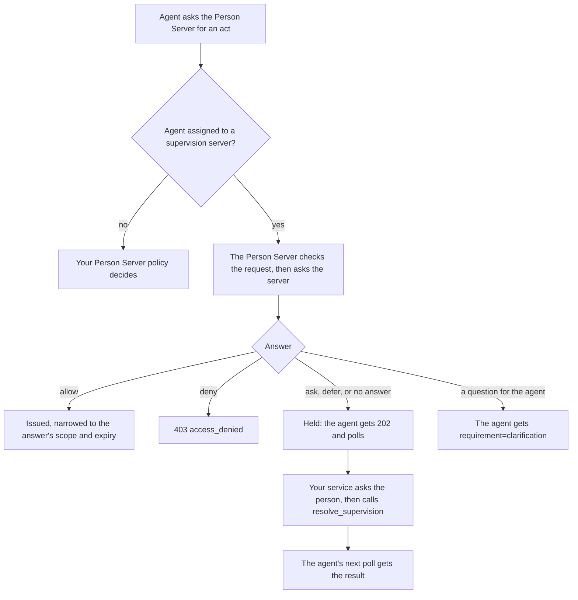

# Supervision

Supervision is the decision on each **act**: each request an agent makes of
its Person Server for a Person token, an Auth token, a permission, or a
mission proposal, update or completion. By default the person decides,
through your Person Server's policy. With a **supervision server**, the Person
Server asks that server instead, for the agents assigned to it; the server
answers from standing rules and asks the person only about the exceptions.

Defined in `draft-hardt-aauth-supervision`. The
[Supervision Server](../roles/supervision-server.md) guide sets up both sides;
this page covers what happens to each act. Terms are defined in
[How AAuth works](../how-aauth-works.md).

## Flow



Whatever the answer, the Person Server then reports what happened to the
server: `person_token.issued`, `auth_token.issued`, `decision.resolved` and
the others, in order.

## Run it

```sh
cargo run --locked -p aauth-rust-person-server --example supervised-agents
```

One person with three agents and two supervision servers: the
organization's server, which allows routine work and asks the person about
sending email, and the person's own server, on a machine that sometimes
sleeps. The output shows how many requests standing policy allowed, that the
person's "always" answer was remembered, that the person decided while their
server slept, and that a stored decision verifies against the server's key.

## The code

From the example: two acts are allowed on standing policy, one is put to the
person, and the person's answer, with "always", is remembered.

<!-- sample: crates/aauth-rust-person-server/examples/supervised_agents/mod.rs -->
```rust ignore
    // One person, many agents, one server applying standing policy.
    for response in [
        world.auth_token(&world.mail, "calendar.read"),
        world.permission(&world.mail, "ArchiveEmail"),
        world.auth_token(&world.research, "calendar.read"),
    ] {
        assert_eq!(response.status(), 200, "{}", text(&response));
        tour.allowed_without_the_person += 1;
    }
    let asked = world.permission(&world.research, "SendEmail");
    assert_eq!(asked.status(), 202, "{}", text(&asked));
    let held = hold(&asked);
    assert!(matches!(&held.waiting, Waiting::Person(ask) if ask.apply_options.len() == 2));
    tour.asked_the_person += 1;
    world.person_answers(&held, Answer::Allow, Some("always"));
    let granted = world.poll(&world.research, &location(&asked));
    assert_eq!(
        body(&granted)["permission"],
        "granted",
        "{}",
        text(&granted)
    );
    assert_eq!(world.ps.deliver_supervision().unwrap(), 0);
    let again = world.permission(&world.research, "SendEmail");
    tour.reach_remembered = body(&again)["permission"] == "granted";
```

## Held acts

A held act answers the agent `202` with a pending URL under the Person
Server's origin; the agent polls it like any deferred answer. Your service reads
`SupervisionHold` from the response's extensions before sending it, or later
with `ps.supervision_hold(reference)`. Its `waiting` says what to do:

| `Waiting` | What your service does |
| --- | --- |
| `Person(ask)` | Show the person the act with the server's summary, recommendation and offered choices, then call `ps.resolve_supervision(reference, answer)`. |
| `Unavailable(reason)` | The server could not be asked. Ask the person yourself and resolve the same way. |
| `Supervisor { retry_after }` | The server will answer later. Call `ps.advance_supervision(reference)` after that many seconds. |
| `Agent { question }` | Nothing. The agent was asked, and its answer goes to the server. |
| `AccessServer { reference }` | Allowed, and the Access Server is waiting. Advance it with `advance_federation`. |
| `Decided` | Nothing. The agent's next poll gets the result. |

`PersonAnswer` carries the person's answer and how far it reaches:
`once`, `mission` (for the rest of the mission) or `always`. The supervision
server, not the Person Server, remembers `mission` and `always` and applies
them to later acts of the same kind by the same agent.

## Reports and records

- Reports for one person and server are delivered in order through an outbox.
  Each request to a server sends its outbox first; call
  `ps.deliver_supervision()` when a server may be reachable again. It returns
  how many still wait.
- When `route` names a new server for an agent, the Person Server first sends
  it the agent's state: its binding, its active missions and its outstanding
  tokens.
- `ps.supervision_record(sdi)` returns each request as signed and each answer
  as received. `record.verify(&keys)` checks the signed answer against the
  server that signed it, so anyone with the record can check later who
  decided.

## Limits

- R3 requests and a Resource's own sign-in step are refused for a supervised
  agent.
- In four-party access, an `allow` that narrows scope or expiry is refused.
- Some reports are not sent: `auth_token.issued` after an Access Server
  deferral, `revocation.received` for Resource tokens,
  `interaction.requested`, and mission endings other than completion.
- [INTERPRETATIONS.md](../../INTERPRETATIONS.md) ("Selected supervision
  interpretations") lists the wire choices made where the draft leaves room.

## Next

- [Supervise agents with a supervision server](../../USE-IN-YOUR-SERVICE.md#supervise-agents-with-a-supervision-server):
  the full reference.
