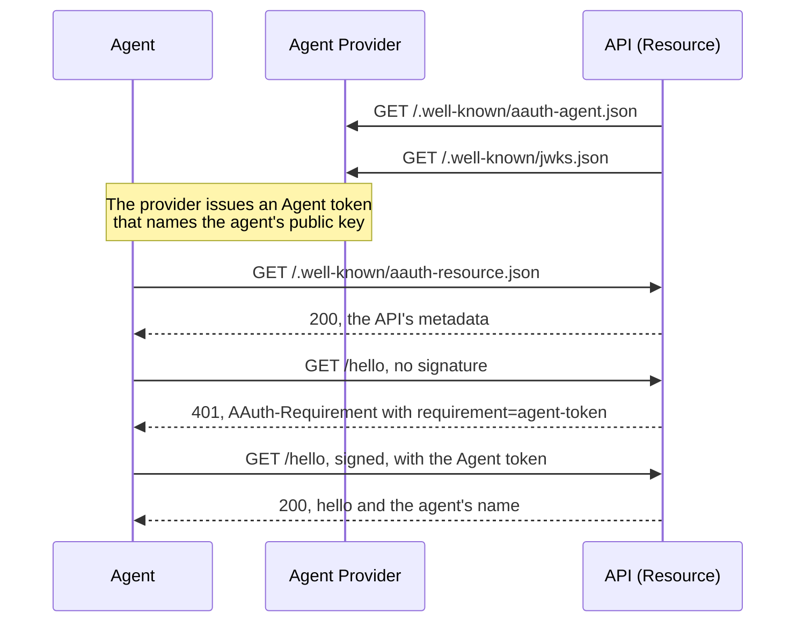

# Get started

This page takes you from a fresh clone to an agent calling an API over TLS on
your own machine. The example runs entirely on that machine: there is no
account to create, no DNS change and no port to open to the outside.

## Before you start

Install [git](https://git-scm.com/), [rustup](https://rustup.rs/) and a C
compiler: `build-essential` on Linux, the Xcode Command Line Tools on macOS, or
the Visual Studio C++ Build Tools on Windows. The example's TLS library needs
the compiler.

## 1. Get the code

```sh
git clone https://gitlab.com/sidecat-dev/aauth-rust.git
cd aauth-rust
git checkout v0.1.0-alpha.26
```

## 2. Run the example

```sh
cargo run --locked -p aauth-rust-resource --example getting-started
```

The first run takes longer: rustup downloads the pinned Rust 1.99.1 (several
hundred MB), and Cargo downloads and builds the dependencies. Then the example
prints:

```text
metadata: 200 issuer=https://api.example
unsigned: 401 requirement=agent-token
signed: 200 hello, aauth:assistant@ap.example
not admitted: 403
```

## 3. What happened

The example starts two HTTPS servers on loopback ports, each with a new
self-signed certificate that the example's client trusts and nothing else does.
The client connects straight to each port and checks the certificate for the
server's name; the names `ap.example` and `api.example` are never looked up,
so nothing outside the program can reach these servers.

- The **Agent Provider** at `ap.example` issues Agent tokens. An **Agent
  token** is a signed statement from the provider: this agent is
  `aauth:assistant@ap.example`, and it holds this public key. That name is an
  agent identifier, `aauth:name@domain`, where the domain is the provider's.
  The provider publishes a metadata document at
  `/.well-known/aauth-agent.json`, which names the URL of its public keys,
  `/.well-known/jwks.json`, so that anyone can check its tokens.
- The **API** at `api.example` is what AAuth calls a **Resource**. At startup
  it fetches the provider's metadata and public keys. It publishes its own
  metadata at `/.well-known/aauth-resource.json`. On each request it checks the
  signature and the Agent token, then asks your policy whether to let this
  agent in.

The agent makes its own key pair. It never sends the private key anywhere: the
provider puts the public key in the Agent token, and the agent signs each
request with the private key.



The four lines of output are four requests:

1. **`metadata: 200 issuer=https://api.example`.** The agent reads the API's
   metadata: its identifier and what it accepts. This library's agent needs it
   only when an API lists more for requests to cover, which this one does not;
   [Signing what a Resource requires](roles/agent.md#signing-what-a-resource-requires)
   shows how. Other clients, such as aauth-go's, read it before calling, so
   serve it from every API.
2. **`unsigned: 401 requirement=agent-token`.** The request had no signature.
   The API answers `401` with an `AAuth-Requirement` header that says what it
   needs: an Agent token.
3. **`signed: 200 hello, aauth:assistant@ap.example`.** The agent signed the
   request. The signature covers the method, the host, the path and the
   `Signature-Key` header, which carries the Agent token. The API checked the
   provider's signature on the token, checked that the request was signed with
   the key the token names, and the policy admitted this agent.
4. **`not admitted: 403`.** A second agent, `aauth:other@ap.example`, signed
   correctly, but the policy admits only the assistant. When your policy
   refuses, the API answers `403` with no `Signature-Error` header, so the
   agent knows its signature was accepted.

## 4. Read the code

The whole program is
[`crates/aauth-rust-resource/examples/getting-started.rs`](../crates/aauth-rust-resource/examples/getting-started.rs).
The HTTP code is in
[`support/tls.rs`](../crates/aauth-rust-resource/examples/support/tls.rs),
which only the examples use.

<!-- sample: crates/aauth-rust-resource/examples/getting-started.rs -->
```rust ignore
//! An Agent calls an API over TLS on this machine.
//!
//! Two servers run on loopback ports: an Agent Provider that issues Agent
//! tokens, and an API that checks them. `support/tls.rs` is a small HTTP/1.1
//! transport for the examples, not a server library.
#[path = "support/tls.rs"]
mod tls;

use aauth_rust_agent::Agent;
use aauth_rust_agent_provider::AgentProvider;
use aauth_rust_core::{
    AgentClaims, AgentProviderKeys, Confirmation, VerifiedAgentToken, metadata_jwks_uri,
};
use aauth_rust_jose::SigningKey;
use aauth_rust_resource::AgentIdentityResource;
use http::{Request, Response};
use std::sync::Arc;
use std::time::{SystemTime, UNIX_EPOCH};

type Error = Box<dyn std::error::Error + Send + Sync>;

fn main() -> Result<(), Error> {
    // The Agent Provider signs Agent tokens and publishes the key that checks them.
    let provider = Arc::new(AgentProvider::new(
        "https://ap.example",
        "ap-key-1",
        SigningKey::generate(),
    )?);
    let published = provider.clone();
    let ap = tls::TlsServer::start("ap.example", move |request| {
        let document = match request.uri().path() {
            "/.well-known/aauth-agent.json" => published.metadata(),
            "/.well-known/jwks.json" => published.jwks(),
            _ => return status(404),
        };
        json(document.unwrap())
    })?;

    // The API fetches the provider's public key over TLS, then checks every request.
    let metadata = ap.send(&get("https://ap.example/.well-known/aauth-agent.json")?)?;
    let jwks_uri = metadata_jwks_uri("https://ap.example", metadata.body())?;
    let jwks = ap.send(&get(&jwks_uri)?)?;
    let keys =
        AgentProviderKeys::from_documents("https://ap.example", metadata.body(), jwks.body())?;
    let resource = AgentIdentityResource::for_origin(
        "https://api.example",
        keys,
        |agent: &VerifiedAgentToken, _: &Request<Vec<u8>>| {
            agent.claims().sub == "aauth:assistant@ap.example"
        },
    )?;
    // The API publishes its own metadata. Clients such as aauth-go's read it first.
    let metadata = resource.metadata()?;
    let api = tls::TlsServer::start("api.example", move |request| {
        if request.uri().path() == "/.well-known/aauth-resource.json" {
            return json(metadata.clone());
        }
        match resource.authorize(&request, now()).into_result() {
            Ok((agent, ())) => Response::new(format!("hello, {}", agent.claims().sub).into_bytes()),
            Err(refusal) => *refusal,
        }
    })?;

    // The agent reads the API's metadata.
    let response = api.send(&get("https://api.example/.well-known/aauth-resource.json")?)?;
    let published: serde_json::Value = serde_json::from_slice(response.body())?;
    println!(
        "metadata: {} issuer={}",
        response.status().as_u16(),
        published["issuer"].as_str().unwrap_or("")
    );

    // Without a signature, the API answers 401 and says what it needs.
    let response = api.send(&get("https://api.example/hello")?)?;
    println!(
        "unsigned: {} {}",
        response.status().as_u16(),
        requirement(&response)
    );

    // The Agent signs the request with its own key and presents its Agent token.
    let assistant = enroll(&provider, "assistant")?;
    let mut request = get("https://api.example/hello")?;
    assistant.sign(&mut request, now())?;
    let response = api.send(&request)?;
    println!(
        "signed: {} {}",
        response.status().as_u16(),
        String::from_utf8_lossy(response.body())
    );

    // A valid signature from an agent the API's policy does not admit gets 403.
    let other = enroll(&provider, "other")?;
    let mut request = get("https://api.example/hello")?;
    other.sign(&mut request, now())?;
    println!("not admitted: {}", api.send(&request)?.status().as_u16());
    Ok(())
}

/// The agent makes its own key; the provider issues a token that names it.
fn enroll(provider: &AgentProvider, name: &str) -> Result<Agent, Error> {
    let key = SigningKey::generate();
    let issued = now();
    let token = provider.issue(&AgentClaims {
        iss: "https://ap.example".into(),
        dwk: "aauth-agent.json".into(),
        sub: format!("aauth:{name}@ap.example"),
        jti: format!("{name}-{issued}"),
        iat: issued,
        exp: issued + 600,
        cnf: Confirmation {
            jwk: key.public_jwk(),
        },
        ps: None,
        parent_agent: None,
        nbf: None,
        extra: Default::default(),
    })?;
    Ok(Agent::new(key, token)?)
}

fn now() -> i64 {
    SystemTime::now()
        .duration_since(UNIX_EPOCH)
        .expect("clock after 1970")
        .as_secs() as i64
}

fn get(uri: &str) -> Result<Request<Vec<u8>>, Error> {
    Ok(Request::builder().uri(uri).body(Vec::new())?)
}

fn json(body: Vec<u8>) -> Response<Vec<u8>> {
    Response::builder()
        .header("content-type", "application/json")
        .body(body)
        .unwrap()
}

fn status(code: u16) -> Response<Vec<u8>> {
    Response::builder().status(code).body(Vec::new()).unwrap()
}

fn requirement(response: &Response<Vec<u8>>) -> &str {
    response
        .headers()
        .get("aauth-requirement")
        .and_then(|value| value.to_str().ok())
        .unwrap_or("")
}
```

The parts that matter in a real service:

- `AgentProvider::issue` signs an Agent token. Before it does, the provider
  decides that this agent is who it says it is. How it decides is up to you.
  For an agent that enrolls a key with the provider and refreshes its token,
  see [Bootstrap](features/bootstrap.md).
- `AgentProviderKeys::from_documents` keeps the provider's published keys. Your
  service fetches those documents, with its own timeouts and limits, from
  providers you have chosen to trust. The library never fetches anything.
- `AgentIdentityResource::for_origin` checks requests sent to one origin. Its
  policy runs only after the signature and token have been checked.
  `into_result` gives your handler the verified token, or gives you the `401`
  or `403` response to send.
- `resource.metadata()` is the document to serve at
  `/.well-known/aauth-resource.json`. The library does not route it for you.
- `Agent::sign` adds the `Signature-Key`, `Signature-Input` and `Signature`
  headers. Call it last, once the URL, headers and body are final.

All times are Unix seconds. A signature is accepted for 60 seconds either side
of the API's clock.

## Next

- [Install](../README.md#install) shows how to use the crates from your own
  project.
- [How AAuth works](how-aauth-works.md) explains the roles and tokens, and the
  ways an API can decide who gets in.
- [Agent](roles/agent.md) and [Resource](roles/resource.md) cover the two
  halves of this example: signing and reading answers, and putting the check
  in front of your own handlers. The `axum` example does the check inside a
  web framework: `cargo run --locked -p aauth-rust-resource --example axum`.
- [Person Server](roles/person-server.md) adds the person: the API learns who
  the agent acts for and what that person allowed.
