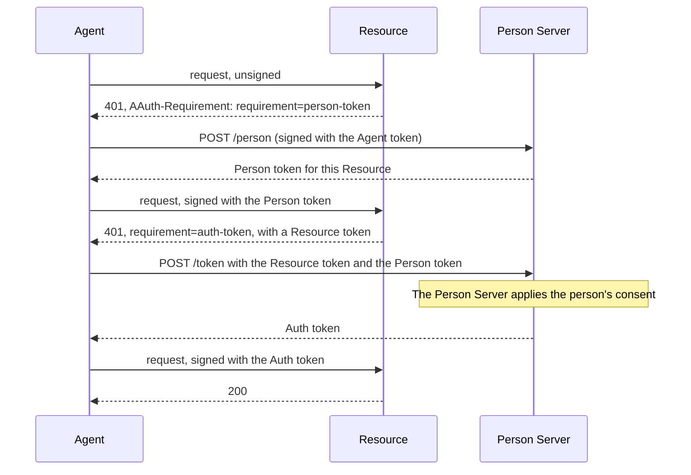
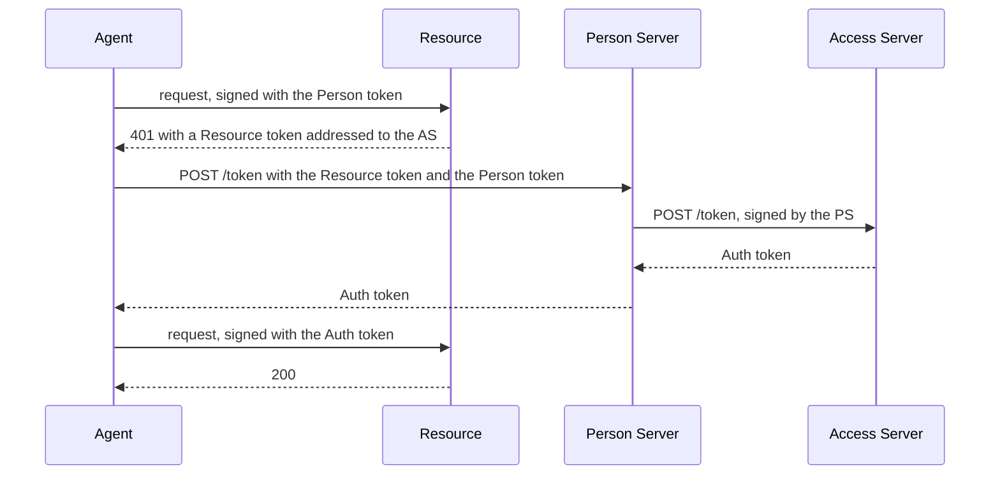

# How AAuth works

AAuth lets an API decide whether to serve a software agent: which agent it is,
which person it acts for, and what that person allowed. This page explains the
parties, the tokens they exchange and the ways an API can decide. The guides
for each role and each feature build on it.

The protocol is defined in a set of drafts by Dick Hardt. This library follows
the versions listed in [SPECIFICATIONS.md](../SPECIFICATIONS.md), and the words
on this page are the drafts' words.

## The parties

| Party | What it does | Crate |
| --- | --- | --- |
| **Person** | The user or organization an agent acts for, and who is accountable for what it does. | none |
| **Agent** | An HTTP client acting for a person. It holds its own signing key, and is named by an **agent identifier** of the form `aauth:name@domain`, such as `aauth:assistant@ap.example`. | `aauth-rust-agent` |
| **Agent Provider (AP)** | Vouches for agents: it issues each agent an Agent token. The agent identifier's domain is the provider's. | `aauth-rust-agent-provider` |
| **Resource** | The API the agent calls. It decides what it requires, and checks every request. | `aauth-rust-resource` |
| **Person Server (PS)** | Speaks for the person: it knows which person each agent acts for, asks for the person's consent, and issues tokens that say so. The person chooses their Person Server. | `aauth-rust-person-server` |
| **Access Server (AS)** | An authorization server that belongs to a Resource. It decides access by the Resource's own rules, instead of leaving the decision to the person's Person Server, and issues tokens for the Resource. | `aauth-rust-access-server` |
| **Supervision Server (SS)** | Approves or refuses an agent's requests for the person, by rules the person or their organization sets. The Person Server asks it first, and it asks the person only when its rules do not decide. | `aauth-rust-supervision-server` |

These are roles, not machines: one server can play several. Each server is
named by an HTTPS origin, such as `https://ps.example`, called its **server
identifier**. It publishes a **metadata document** at a well-known path, for
example `https://ps.example/.well-known/aauth-person.json`: a small JSON file
that names its endpoints and its **JWKS**, the set of public keys that check
its signatures.

## Signed requests

Every request an agent sends is signed with the agent's private key, using HTTP
Message Signatures ([RFC 9421](https://www.rfc-editor.org/rfc/rfc9421)). Three
headers carry the signature:

- `Signature-Key` carries the token that names the signing key, so the server
  knows which key to check the signature with. The way the key is carried is
  called the **scheme**; AAuth agents use the `jwt` scheme, which carries a
  token.
- `Signature-Input` lists what the signature covers: here, at least the method,
  the host, the path, the query when there is one, and `Signature-Key` itself.
  When the request has a body, the signature also covers a `Content-Digest`
  header, a SHA-256 hash of the body.
- `Signature` is the signature.

A server that refuses a signature answers `401` with a `Signature-Error` header
naming the reason. [Errors](errors.md) lists the reasons and what to do about
each.

## Tokens

All AAuth tokens are signed JWTs. Agent, Person and Auth tokens name the
agent's public key in their `cnf` (confirmation) claim, and a server accepts
one only on a request signed with the matching private key: a stolen token is
useless without the agent's key.

A **scope** is a name for a kind of access, such as `notes.read`, that a
Resource defines and describes in its metadata.

| Token | Issued by | Says |
| --- | --- | --- |
| **Agent token** | Agent Provider | This is agent `aauth:assistant@ap.example`, and this is its key. It may name the agent's Person Server in a `ps` claim. |
| **Person token** | Person Server | This agent acts for this person, at this one Resource. It names the person with an identifier that only that Resource sees. It gives no access by itself: the agent uses it to get an Auth token. |
| **Resource token** | Resource | A challenge, signed by the Resource: these scopes are needed, for this agent and person, from this Person Server or Access Server. It names the agent's key by its thumbprint, a hash of the public key. |
| **Auth token** | Person Server or Access Server | This agent may use these scopes at this Resource, for this person, until this time. |

## Challenges and waiting

A server says what a request needs in an `AAuth-Requirement` response header.
The value of `requirement` is one of:

| Value | Status | The agent should |
| --- | --- | --- |
| `agent-token` | 401 | sign the request with its Agent token |
| `person-token` | 401 | get a Person token for this Resource from its Person Server |
| `auth-token` | 401 | take the Resource token in the header to its Person Server, and exchange it for an Auth token |
| `interaction` | 202 | send the person to the URL in the header, then poll |
| `approval` | 202 | wait for someone to approve, then poll |
| `clarification` | 202 | answer the question in the body |
| `claims` | 202 | (Access Server to Person Server only) supply the identity claims asked for |

A `202 Accepted` response is a **deferred** answer: the answer is not ready
yet. It has a `Location` header naming a **pending URL**. The agent sends
signed `GET` requests to that URL, waiting at least `Retry-After` seconds
between them, until the response is not `202`. The Rust agent prepares these
polls with `PollSession`.

## How an API decides

The drafts define five ways, called access modes. A Resource can use a
different one on each endpoint.

| Mode | The Resource learns | Who says so | In this library |
| --- | --- | --- | --- |
| Agent identity | which agent | the Agent Provider | `AgentIdentityResource` |
| Resource-managed | which person | the Resource's own sign-in | `SessionLedger` (Resource) and `AccessSession` (agent) |
| Person identity | which person | the Person Server | no Resource helper |
| PS authorization (three-party) | the person and what they consented to | the Person Server | `PsAuthorizationResource::new` |
| Federated authorization (four-party) | the person and the Access Server's decision | the Access Server | `PsAuthorizationResource::new_federated` |

The counts are the parties in the exchange: agent, Resource and Person Server
make three; an Access Server makes four.

- **Agent identity.** The agent signs with its Agent token, and the Resource
  decides from who the agent is. This replaces an API key with the agent's own
  key. [Get started](getting-started.md) runs this mode.
- **Resource-managed.** The Resource signs the person in by its own means,
  then hands the agent a session token in an `AAuth-Access` header, which the
  agent sends back in `Authorization`.
- **Person identity.** The Resource serves requests signed with a Person
  token. This library has no helper for it: `PsAuthorizationResource` answers
  a Person token by asking for an Auth token.
- **Three-party** and **four-party**, below.

### Three-party: the Person Server authorizes

The Resource wants to know the person, and that the person allowed the access.
It trusts the Person Server that issued the agent's Person token. The agent
finds its Person Server in the `ps` claim of its Agent token.

[Person Server](roles/person-server.md) runs this flow.

### Four-party: the Access Server decides

The Resource has its own Access Server. Its Resource token is addressed to that
Access Server, and the Person Server asks the Access Server for the Auth token
after the person consents.

[Access Server](roles/access-server.md) runs this flow.

## Missions and supervision

A person can require their agent to work under a **mission**: a description of
a task, which the agent proposes and the person approves at the Person Server.
Tokens obtained under a mission carry its hash, `mission_s256`, so each request
can be checked against the task. [Missions](features/missions.md) covers this.

Each request the agent makes of its Person Server, such as for a token or for
permission to act, is decided by the person, or by a
[supervision server](features/supervision.md) that decides for them.

## What the library leaves to you

The libraries sign, check and decide, and open no connections. Your service:

- sends and receives the HTTP messages, over TLS;
- chooses which Agent Providers, Person Servers and Access Servers to trust,
  fetches their metadata and keys with its own limits and timeouts, and
  refreshes them. It gives the library a **resolver**: an object that returns
  a trusted server's public key, given the server's identifier, its metadata
  document's name and the key ID;
- signs people in and records their consent;
- stores what the Person Server and Access Server must remember, using the
  store interfaces the crates define;
- protects its signing keys;
- makes repeated requests safe: a signed request can be replayed within its
  60-second window, so an operation that changes state needs its own
  idempotency key.

[SECURITY.md](../SECURITY.md) and [USE-IN-YOUR-SERVICE.md](../USE-IN-YOUR-SERVICE.md)
cover each of these in detail.
