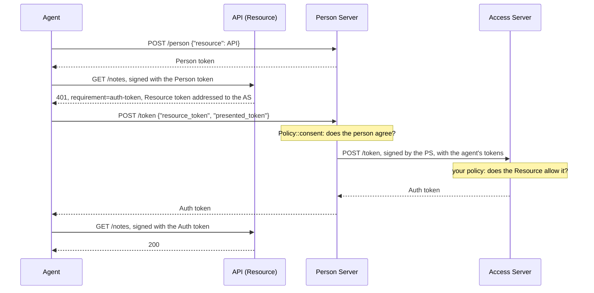

# Access Server

An Access Server is an authorization server that belongs to a Resource: it
decides access by the Resource's own rules, instead of leaving the decision to
the person's Person Server. The Resource addresses its Resource token to the
Access Server instead of the Person Server. The Person Server, once the person consents, sends that
token to the Access Server, which applies the Resource's policy and issues the
Auth token. This is four-party access: agent, Resource, Person Server and
Access Server.

Crate: `aauth-rust-access-server`. Terms are defined in
[How AAuth works](../how-aauth-works.md).

## Flow



Three parties each make a decision: the Person Server asks the person, the
Access Server applies the Resource's policy, and the Resource checks the Auth
token on every request.

## Smallest working code

This program runs the flow above in one process. The `ToAccessServer` adapter
stands for the HTTPS connection from the Person Server to the Access Server.

```rust
use aauth_rust_access_server as access;
use aauth_rust_agent::{Agent, FederatedContext, Requirement};
use aauth_rust_agent_provider::AgentProvider;
use aauth_rust_core::{
    AgentClaims, AgentKeyResolver, Confirmation, TokenError, TrustedIssuerKeys, VerifiedAuthToken,
};
use aauth_rust_jose::{Jwk, SigningKey};
use aauth_rust_person_server::{
    AuthorizationRequest, Config, Federation, FederationError, Grant, MemoryStore, Person,
    PersonRequest, PersonServer, Policy, PolicyError,
};
use aauth_rust_resource::{PsAuthorizationConfig, PsAuthorizationResource};
use http::{Request, Response};
use serde_json::{Value, json};
use std::collections::BTreeMap;
use std::error::Error;
use std::sync::atomic::{AtomicU64, Ordering};
use std::sync::{Arc, RwLock};
use std::time::{SystemTime, UNIX_EPOCH};

const AP: &str = "https://ap.example";
const PS: &str = "https://ps.example";
const AS: &str = "https://as.example";
const API: &str = "https://api.example";

/// The Person Server's decisions. With an Access Server, `consent` is called
/// instead of `authorize`.
struct People;
impl Policy for People {
    fn bind_person(&self, request: &PersonRequest) -> Result<Person, PolicyError> {
        if request.agent.claims().sub != "aauth:assistant@ap.example" {
            return Err(PolicyError::Denied);
        }
        Ok(Person {
            id: "person-1".into(),
            subject: "u-7f3c9a".into(),
            tenant: None,
        })
    }
    fn authorize(&self, _: &AuthorizationRequest) -> Result<Grant, PolicyError> {
        Err(PolicyError::Denied)
    }
    fn consent(&self, request: &AuthorizationRequest) -> Result<(), PolicyError> {
        // The person agrees to let the assistant read notes at this API.
        if request.resource.claims().iss == API && request.scopes == ["notes.read"] {
            Ok(())
        } else {
            Err(PolicyError::Denied)
        }
    }
}

/// How the Person Server reaches Access Servers. Yours accepts only the
/// Access Servers you trust, reads their metadata and sends over HTTPS.
struct ToAccessServer(Arc<dyn Fn(&Request<Vec<u8>>) -> Response<Vec<u8>> + Send + Sync>);
impl Federation for ToAccessServer {
    fn endpoint(&self, access_server: &str) -> Result<String, FederationError> {
        if access_server == AS {
            Ok(format!("{AS}/token"))
        } else {
            Err(FederationError)
        }
    }
    fn send(&self, request: &Request<Vec<u8>>) -> Result<Response<Vec<u8>>, FederationError> {
        Ok((self.0)(request))
    }
}

/// The servers this deployment trusts, keyed by identifier and metadata document.
#[derive(Clone, Default)]
struct Trust(Arc<RwLock<BTreeMap<(String, String), TrustedIssuerKeys>>>);
impl Trust {
    fn add(
        &self,
        issuer: &str,
        dwk: &str,
        metadata: &[u8],
        jwks: &[u8],
    ) -> Result<(), Box<dyn Error>> {
        let keys = TrustedIssuerKeys::from_documents(issuer, dwk, metadata, jwks)?;
        self.0
            .write()
            .unwrap()
            .insert((issuer.into(), dwk.into()), keys);
        Ok(())
    }
}
impl AgentKeyResolver for Trust {
    fn key(&self, issuer: &str, dwk: &str, kid: &str) -> Result<Jwk, TokenError> {
        let trusted = self.0.read().map_err(|_| TokenError::InvalidKey)?;
        let keys = trusted
            .get(&(issuer.into(), dwk.into()))
            .ok_or(TokenError::UntrustedIssuer)?;
        keys.key(issuer, dwk, kid)
    }
}

fn now() -> i64 {
    SystemTime::now()
        .duration_since(UNIX_EPOCH)
        .unwrap()
        .as_secs() as i64
}

fn get(uri: &str) -> Result<Request<Vec<u8>>, Box<dyn Error>> {
    Ok(Request::builder().uri(uri).body(Vec::new())?)
}

fn post(agent: &Agent, uri: &str, body: Value) -> Result<Request<Vec<u8>>, Box<dyn Error>> {
    let mut request = Request::builder()
        .method("POST")
        .uri(uri)
        .header("content-type", "application/json")
        .body(serde_json::to_vec(&body)?)?;
    agent.sign(&mut request, now())?;
    Ok(request)
}

fn token(response: Response<Vec<u8>>, name: &str) -> Result<String, Box<dyn Error>> {
    if response.status() != 200 {
        return Err(format!("refused: {}", String::from_utf8_lossy(response.body())).into());
    }
    let body: Value = serde_json::from_slice(response.body())?;
    Ok(body[name]
        .as_str()
        .ok_or("no token in the response")?
        .to_owned())
}

fn main() -> Result<(), Box<dyn Error>> {
    let trust = Trust::default();

    // The Agent Provider and the agent. The Access Server requires the Agent
    // token's `ps` claim to name the Person Server that asks for it.
    let provider = AgentProvider::new(AP, "ap-1", SigningKey::generate())?;
    trust.add(
        AP,
        "aauth-agent.json",
        &provider.metadata()?,
        &provider.jwks()?,
    )?;
    let key = SigningKey::generate();
    let agent_token = provider.issue(&AgentClaims {
        iss: AP.into(),
        dwk: "aauth-agent.json".into(),
        sub: "aauth:assistant@ap.example".into(),
        jti: "assistant-1".into(),
        iat: now(),
        exp: now() + 3600,
        cnf: Confirmation {
            jwk: key.public_jwk(),
        },
        ps: Some(PS.into()),
        parent_agent: None,
        nbf: None,
        extra: Default::default(),
    })?;
    let agent = Agent::new(key, agent_token)?;

    // The Access Server and the API's policy: Person Server ps.example may
    // have `notes.read` for an hour.
    let as_ids = AtomicU64::new(0);
    let access_server = Arc::new(access::AccessServer::new(
        access::Config::new(AS, "as-1", SigningKey::generate()),
        trust.clone(),
        |request: &access::AuthorizationRequest| {
            if request.person_server == PS && request.scopes == ["notes.read"] {
                Ok(access::Decision {
                    scopes: request.scopes.clone(),
                    lifetime: 3600,
                })
            } else {
                Err(access::PolicyError::Denied)
            }
        },
        now,
        move || format!("as-{}", as_ids.fetch_add(1, Ordering::SeqCst)),
    )?);
    let metadata = access_server.handle(&get(&format!("{AS}/.well-known/aauth-access.json"))?);
    let jwks = access_server.handle(&get(&format!("{AS}/.well-known/jwks.json"))?);
    trust.add(AS, "aauth-access.json", metadata.body(), jwks.body())?;

    // The Person Server, which reaches the Access Server through the adapter.
    let reach = access_server.clone();
    let ps_ids = AtomicU64::new(0);
    let ps = PersonServer::new(
        Config::new(PS, "ps-1", SigningKey::generate()),
        trust.clone(),
        MemoryStore::default(),
        People,
        now,
        move || format!("ps-{}", ps_ids.fetch_add(1, Ordering::SeqCst)),
    )?
    .with_federation(ToAccessServer(Arc::new(
        move |request: &Request<Vec<u8>>| reach.handle(request),
    )));
    let metadata = ps.handle(&get(&format!("{PS}/.well-known/aauth-person.json"))?);
    let jwks = ps.handle(&get(&format!("{PS}/.well-known/jwks.json"))?);
    trust.add(PS, "aauth-person.json", metadata.body(), jwks.body())?;

    // The API accepts Auth tokens from its Access Server only.
    let api = PsAuthorizationResource::new_federated(
        PsAuthorizationConfig {
            issuer: API.into(),
            signed_origin: API.into(),
            kid: "api-1".into(),
            signing_key: SigningKey::generate(),
            scopes: vec!["notes.read".into()],
            scope_descriptions: BTreeMap::from([("notes.read".into(), "Read your notes".into())]),
        },
        AS,
        trust.clone(),
        |_: &VerifiedAuthToken, _: &Request<Vec<u8>>| true,
    )?;
    trust.add(API, "aauth-resource.json", &api.metadata()?, &api.jwks()?)?;

    // The agent: a Person token, then the API's challenge.
    let person = token(
        ps.handle(&post(
            &agent,
            &format!("{PS}/person"),
            json!({"resource": API}),
        )?),
        "person_token",
    )?;
    let mut call = get(&format!("{API}/notes"))?;
    agent.with_token(person.clone())?.sign(&mut call, now())?;
    let challenge = api.authorize(&call, now(), "challenge-1").into_response();
    let Some(Requirement::AuthToken { resource_token }) =
        Requirement::from_headers(challenge.headers())?
    else {
        return Err("expected an auth-token requirement".into());
    };
    let expected = FederatedContext {
        resource: API,
        person_server: PS,
        access_server: AS,
        presented_token: &person,
    };
    let resource =
        agent.verify_federated_resource_challenge(&resource_token, &expected, &trust, now())?;

    // The Person Server asks the Access Server, and returns its Auth token.
    let exchange = json!({"resource_token": resource_token, "presented_token": person});
    let auth = token(
        ps.handle(&post(&agent, &format!("{PS}/token"), exchange)?),
        "auth_token",
    )?;
    agent.verify_federated_auth_delivery(&auth, &resource, &expected, &trust, now())?;

    // The API admits the Access Server's Auth token.
    let mut call = get(&format!("{API}/notes"))?;
    agent.with_token(auth)?.sign(&mut call, now())?;
    let (granted, ()) = api
        .authorize(&call, now(), "challenge-2")
        .into_result()
        .map_err(|refusal| format!("refused with {}", refusal.status()))?;
    assert_eq!(granted.claims().iss, AS);
    Ok(())
}
```

## The Access Server

`AccessServer::new(config, keys, policy, clock, ids)` takes:

- `Config::new(issuer, kid, signing_key)`. Set `signed_origin` as well when
  requests arrive on another port.
- `keys`, a resolver for the Person Servers you accept
  (`aauth-person.json`), the Agent Providers (`aauth-agent.json`) and your
  Resources (`aauth-resource.json`).
- `policy`, which receives an `AuthorizationRequest` after every signature and
  token has been checked: the Person Server, the agent, the Resource token and
  the requested scopes. Return a `Decision` with a non-empty subset of the
  scopes and a lifetime of at most 3600 seconds, `PolicyError::Denied` for a
  `403`, or `PolicyError::Unavailable` for a `500`. When a supervision server
  narrowed the person's approval, the Person Server sends a narrower `scope`
  and an `exp` with its request: `scopes` is then that narrower set, and the
  token ends no later than `expires_at`.
- a clock in Unix seconds, and unique token IDs.

`handle` serves `/.well-known/aauth-access.json`, `/.well-known/jwks.json` and
`POST /token`. The Access Server opens no connections. With `with_revocation`,
a Person Server's revocation of a person token revokes the Auth tokens issued
against it at their Resources, through the directory you install with
`with_revocation_directory`; `RevocationClient` in `aauth-rust-discovery`
delivers them over HTTPS ([Discovery and revocation delivery](../discovery.md)).

To answer later rather than at once, for approval, payment, a question or
identity claims, use `with_deferred`; see
[Deferred answers at the Access Server and Person Server](../../USE-IN-YOUR-SERVICE.md#configure-as-and-ps-continuations).
`cargo run --locked -p aauth-rust-resource --example four-party -- --deferred`
runs payment and approval over TLS.

## The Person Server side

- `with_federation(adapter)` makes the Person Server send `/token` requests to
  the Access Server named by the Resource token. Once it is on, the Person
  Server sends every `/token` request to an Access Server and no longer issues
  Auth tokens itself. To do both, run two instances and route between them, as
  the
  [mixed-grants example](../../USE-IN-YOUR-SERVICE.md#serve-direct-and-federated-grants-from-one-person-server-origin)
  does.
- `Policy::consent` decides for the person. It refuses unless you implement
  it.
- The adapter's `endpoint` refuses Access Servers you do not trust, and
  returns the token endpoint from a trusted one's metadata; `send` sends the
  signed request unchanged, following no redirects. When the Access Server cannot be reached, the agent gets
  `502 as_unreachable`. `DiscoveryClient::fetch_metadata` and
  `DiscoveryClient::send` in `aauth-rust-discovery` do both halves over
  admitted HTTPS; the adapter still decides which Access Servers it trusts.

## The Resource and the agent

- The Resource uses `PsAuthorizationResource::new_federated(config, AS, keys, policy)`.
  It accepts Auth tokens from that Access Server only.
- The agent checks the challenge and the Auth token with
  `verify_federated_resource_challenge` and `verify_federated_auth_delivery`,
  against a `FederatedContext` naming the Resource, Person Server and Access
  Server it expects.

## Limits

- The Agent token must carry `ps`, equal to the Person Server that signs the
  request; otherwise the answer is `400 invalid_agent_token`. Call chaining is
  the exception: see [Call chaining](../features/call-chaining.md).
- The Access Server publishes one key and has no key rotation schedule.
- With `with_r3`, the Access Server issues R3 Auth tokens for class
  documents and grants their operations outright: it issues no
  `r3_per_call`, and refuses per-call proposals. See [R3](../features/r3.md).

## Next

- [Run an Access Server and federated Person Server](../../USE-IN-YOUR-SERVICE.md#run-an-access-server-and-federated-person-server):
  the full reference.
- The four-party example runs this flow over TLS:
  `cargo run --locked -p aauth-rust-resource --example four-party`.
