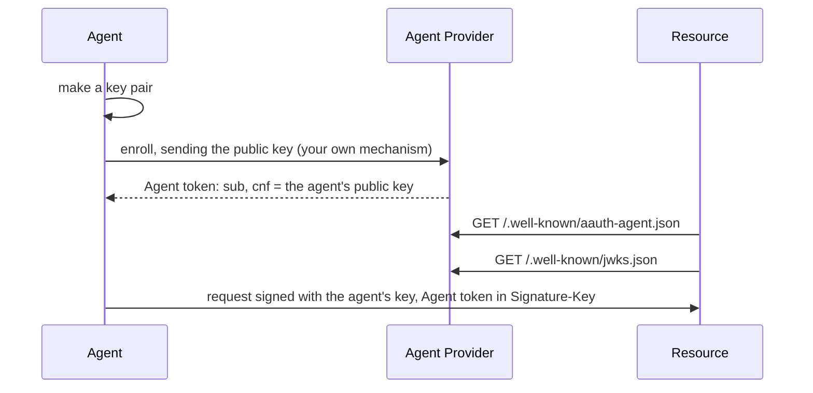

# Agent Provider

An Agent Provider vouches for agents. It decides that an agent is genuine, by
whatever means fits your platform, and then issues it an **Agent token**: a
JWT, signed with the provider's key, that names the agent and the agent's
public key. Resources and Person Servers check that signature with the public
key the provider publishes.

Crate: `aauth-rust-agent-provider`. Terms are defined in
[How AAuth works](../how-aauth-works.md).

## Flow



## Smallest working code

This program issues a token, produces the two documents the provider
publishes, and checks the token the way a Resource does.

```rust
use aauth_rust_agent_provider::AgentProvider;
use aauth_rust_core::{AgentClaims, AgentProviderKeys, AgentToken, Confirmation};
use aauth_rust_jose::SigningKey;
use std::time::{SystemTime, UNIX_EPOCH};

fn main() -> Result<(), Box<dyn std::error::Error>> {
    let now = SystemTime::now().duration_since(UNIX_EPOCH)?.as_secs() as i64;

    // The provider's identifier, the key ID it publishes, and its signing key.
    // Load the key from your key store; generate() makes a new one.
    let provider = AgentProvider::new("https://ap.example", "ap-key-1", SigningKey::generate())?;

    // The agent made this key pair and sent you the public half when it enrolled.
    let agent_key = SigningKey::generate();

    // Your enrollment decided that this agent is genuine. Issue its token.
    let token = provider.issue(&AgentClaims {
        iss: "https://ap.example".into(),
        dwk: "aauth-agent.json".into(),
        sub: "aauth:assistant@ap.example".into(),
        jti: "issuance-0001".into(),
        iat: now,
        exp: now + 3600,
        cnf: Confirmation {
            jwk: agent_key.public_jwk(),
        },
        ps: Some("https://ps.example".into()),
        parent_agent: None,
        nbf: None,
        extra: Default::default(),
    })?;

    // Serve these two documents to anyone, at these paths.
    let metadata = provider.metadata()?; // GET /.well-known/aauth-agent.json
    let jwks = provider.jwks()?; // GET /.well-known/jwks.json

    // A Resource or Person Server that trusts this provider checks the token
    // with the keys from those documents.
    let keys = AgentProviderKeys::from_documents("https://ap.example", &metadata, &jwks)?;
    let verified = AgentToken::parse(&token)?.verify(&keys, now)?;
    assert_eq!(verified.claims().sub, "aauth:assistant@ap.example");
    Ok(())
}
```

The claims:

- `iss` is the provider's server identifier, and `dwk` is always
  `aauth-agent.json`, the name of the provider's metadata document.
- `sub` is the **agent identifier**, `aauth:local@domain`. Its domain must be
  the provider's host. Give an agent the same identifier every time you
  renew its token.
- `jti` must be unique for every token you issue.
- `iat` and `exp` are Unix seconds. The library refuses a lifetime over 24
  hours.
- `cnf.jwk` is the agent's public key. Every request the agent signs must
  verify with it.
- `ps` names the agent's Person Server. If the agent has one, put it here:
  the drafts require it, and this library's Access Server refuses an Agent
  token without it.
- `extra` holds further claims; their meaning is up to you and the parties you
  agree with.

## When the agent and the provider are separate programs

The agent's private key never goes to the provider. The agent loads its key,
sends the provider only the public half, `public_jwk()`, which is plain JSON,
and keeps the token it gets back. A `SigningKey` cannot be written out: it has
no method that returns the private key. So create the key outside the program,
as a PKCS #8 file, and load it each time the agent starts:

```sh
openssl genpkey -algorithm ed25519 -outform DER -out agent-key.der
```

<!-- checked: pkcs8-prefix -->
```rust
use aauth_rust_agent::Agent;
use aauth_rust_agent_provider::AgentProvider;
use aauth_rust_core::{AgentClaims, Confirmation};
use aauth_rust_jose::{Jwk, SigningKey};
use std::time::{SystemTime, UNIX_EPOCH};

/// An Ed25519 key in PKCS #8 DER: the test key from RFC 8410. Read yours from
/// the file instead: `std::fs::read("agent-key.der")?`.
const AGENT_KEY_DER: [u8; 48] = [
    0x30, 0x2e, 0x02, 0x01, 0x00, 0x30, 0x05, 0x06, 0x03, 0x2b, 0x65, 0x70, 0x04, 0x22, 0x04, 0x20,
    0xd4, 0xee, 0x72, 0xdb, 0xf9, 0x13, 0x58, 0x4a, 0xd5, 0xb6, 0xd8, 0xf1, 0xf7, 0x69, 0xf8, 0xad,
    0x3a, 0xfe, 0x7c, 0x28, 0xcb, 0xf1, 0xd4, 0xfb, 0xe0, 0x97, 0xa8, 0x8f, 0x44, 0x75, 0x58, 0x42,
];

fn main() -> Result<(), Box<dyn std::error::Error>> {
    let now = SystemTime::now().duration_since(UNIX_EPOCH)?.as_secs() as i64;

    // The agent program: load its key, and send the public half to enroll.
    let key = SigningKey::from_pkcs8_der("Ed25519", &AGENT_KEY_DER)?;
    let enrollment = serde_json::to_string(&key.public_jwk())?;

    // The provider program: it receives only the public key.
    let provider = AgentProvider::new("https://ap.example", "ap-key-1", SigningKey::generate())?;
    let public_key: Jwk = serde_json::from_str(&enrollment)?;
    let token = provider.issue(&AgentClaims {
        iss: "https://ap.example".into(),
        dwk: "aauth-agent.json".into(),
        sub: "aauth:assistant@ap.example".into(),
        jti: "issuance-0002".into(),
        iat: now,
        exp: now + 3600,
        cnf: Confirmation { jwk: public_key },
        ps: None,
        parent_agent: None,
        nbf: None,
        extra: Default::default(),
    })?;

    // The agent program, started again: the same key file and the token it
    // stored. Agent::new checks that the token names this key.
    let agent = Agent::new(
        SigningKey::from_pkcs8_der("Ed25519", &AGENT_KEY_DER)?,
        token,
    )?;
    assert_eq!(
        agent.public_jwk().thumbprint()?,
        key.public_jwk().thumbprint()?
    );
    Ok(())
}
```

The provider's own signing key is loaded the same way. `SigningKey::from_seed`
takes a 32-byte seed instead, if your key store holds seeds. Keep the key file
readable only by the program that uses it.

## What your service supplies

- **Enrollment.** How an agent proves to you that it is genuine: a platform
  attestation, a person signing in, a key the person controls. The library
  has no enrollment endpoint; the Bootstrap draft that describes one is not
  implemented.
- **The signing key**, kept safe and loaded at start, as above.
- **Publishing.** Serve `metadata()` and `jwks()` over HTTPS. `jwks()`
  publishes only the current key. After you change keys, servers that refresh
  your JWKS reject tokens signed with the old key. To change keys without
  breaking live tokens, publish your own JWKS with both keys, each under its
  own key ID, until the old tokens expire.
- **Renewal.** Issue a new token before the old one expires, naming the same
  public key. The agent switches with `agent.with_token(new_token)`.

## Also in this crate

- `issue_subagent` issues a token for a sub-agent: an agent that a parent
  agent starts to do part of its work, one level below it. See
  [Obtain credentials for a one-level sub-agent](../../USE-IN-YOUR-SERVICE.md#obtain-credentials-for-a-one-level-sub-agent).
- `with_display` adds a name and logo to the metadata, which a Person Server
  can show when a person approves a new agent. See
  [Publish display metadata](../../USE-IN-YOUR-SERVICE.md#publish-display-metadata).
- `with_event_endpoint` makes the provider an inbox where APIs send events
  for its agents. See [Events](../features/events.md).

## Next

- [Agent](agent.md): what the agent does with its token.
- [Keep Agent credentials fresh](../../USE-IN-YOUR-SERVICE.md#keep-agent-credentials-fresh)
  and [Rotation and discovery documents](../../USE-IN-YOUR-SERVICE.md#rotation-and-discovery-documents).
