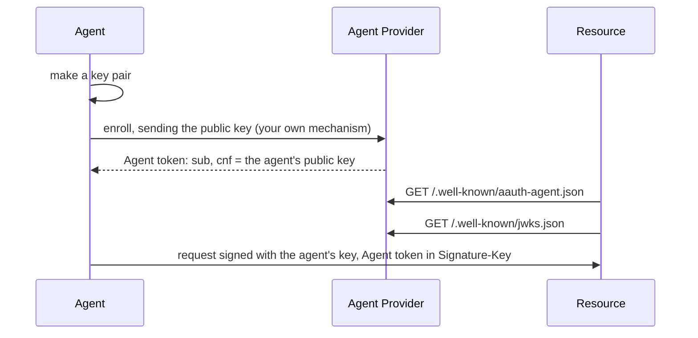

# Agent Provider

An Agent Provider vouches for agents. It decides that an agent is genuine, by
whatever means fits your platform, and then issues it an **Agent token**: a
JWT, signed with the provider's key, that names the agent and the agent's
public key. Resources and Person Servers check that signature with the public
key the provider publishes.

Crate: `aauth-rust-agent-provider`. Terms are defined in
[How AAuth works](../how-aauth-works.md).

## Flow



## Smallest working code

This program issues a token, produces the two documents the provider
publishes, and checks the token the way a Resource does.

```rust
use aauth_rust_agent_provider::AgentProvider;
use aauth_rust_core::{AgentClaims, AgentProviderKeys, AgentToken, Confirmation};
use aauth_rust_jose::SigningKey;
use std::time::{SystemTime, UNIX_EPOCH};

fn main() -> Result<(), Box<dyn std::error::Error>> {
    let now = SystemTime::now().duration_since(UNIX_EPOCH)?.as_secs() as i64;

    // The provider's identifier, the key ID it publishes, and its signing key.
    // Load the key from your key store; generate() makes a new one.
    let provider = AgentProvider::new("https://ap.example", "ap-key-1", SigningKey::generate())?;

    // The agent made this key pair and sent you the public half when it enrolled.
    let agent_key = SigningKey::generate();

    // Your enrollment decided that this agent is genuine. Issue its token.
    let token = provider.issue(&AgentClaims {
        iss: "https://ap.example".into(),
        dwk: "aauth-agent.json".into(),
        sub: "aauth:assistant@ap.example".into(),
        jti: "issuance-0001".into(),
        iat: now,
        exp: now + 3600,
        cnf: Confirmation {
            jwk: agent_key.public_jwk(),
        },
        ps: Some("https://ps.example".into()),
        parent_agent: None,
        nbf: None,
        extra: Default::default(),
    })?;

    // Serve these two documents to anyone, at these paths.
    let metadata = provider.metadata()?; // GET /.well-known/aauth-agent.json
    let jwks = provider.jwks()?; // GET /.well-known/jwks.json

    // A Resource or Person Server that trusts this provider checks the token
    // with the keys from those documents.
    let keys = AgentProviderKeys::from_documents("https://ap.example", &metadata, &jwks)?;
    let verified = AgentToken::parse(&token)?.verify(&keys, now)?;
    assert_eq!(verified.claims().sub, "aauth:assistant@ap.example");
    Ok(())
}
```

The claims:

- `iss` is the provider's server identifier, and `dwk` is always
  `aauth-agent.json`, the name of the provider's metadata document.
- `sub` is the **agent identifier**, `aauth:local@domain`. Its domain must be
  the provider's host. Give an agent the same identifier every time you
  renew its token.
- `jti` must be unique for every token you issue.
- `iat` and `exp` are Unix seconds. The library refuses a lifetime over 24
  hours.
- `cnf.jwk` is the agent's public key. Every request the agent signs must
  verify with it.
- `ps` names the agent's Person Server, if it has one. An agent with a Person
  Server must carry it, and this library's Access Server requires it.
- `extra` holds further claims; their meaning is up to you and the parties you
  agree with.

## What your service supplies

- **Enrollment.** How an agent proves to you that it is genuine: a platform
  attestation, a person signing in, a key the person controls. The library
  has no enrollment endpoint; the Bootstrap draft that describes one is not
  implemented.
- **The signing key**, kept safe. `SigningKey::from_pkcs8_der` loads an
  existing key.
- **Publishing.** Serve `metadata()` and `jwks()` over HTTPS. `jwks()` holds
  only the current key, and the provider has no rotation schedule: if you
  replace the key, tokens signed with the old one stop verifying once
  verifiers refresh. To keep them working through a change, serve your own
  JWKS that holds both public keys under different key IDs.
- **Renewal.** Issue a new token before the old one expires, naming the same
  public key. The agent switches with `agent.with_token(new_token)`.

## Also in this crate

- `issue_subagent` issues a token for a sub-agent, one level below a parent
  agent. See
  [Obtain credentials for a one-level sub-agent](../../USE-IN-YOUR-SERVICE.md#obtain-credentials-for-a-one-level-sub-agent).
- `with_display` adds a name and logo to the metadata, which a Person Server
  can show when a person approves a new agent. See
  [Publish display metadata](../../USE-IN-YOUR-SERVICE.md#publish-display-metadata).
- `with_event_endpoint` makes the provider an inbox for the agent's events.
  See [Events](../features/events.md).

## Next

- [Agent](agent.md): what the agent does with its token.
- [Keep Agent credentials fresh](../../USE-IN-YOUR-SERVICE.md#keep-agent-credentials-fresh)
  and [Rotation and discovery documents](../../USE-IN-YOUR-SERVICE.md#rotation-and-discovery-documents).
