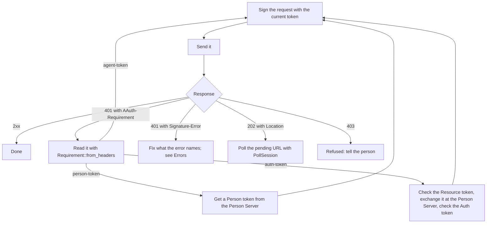

# Agent

An agent is an HTTP client acting for a person. With this crate it holds its
private key and its current token, signs each request, reads what servers ask
for, and checks the tokens they send back before using them.

The crate does not send requests, wait or retry; your HTTP client does, so
nothing is sent twice unless you send it twice.

Crate: `aauth-rust-agent`. Terms are defined in
[How AAuth works](../how-aauth-works.md).

## Flow

What an agent does with each response:



## Smallest working code

The `call` function signs a request, sends it, and says what the answer asks
for. `main` sets up an Agent Provider and an API in the same process so that
the program runs on its own; in your code, `send` is your HTTP client.

```rust
use aauth_rust_agent::{Agent, Requirement};
use aauth_rust_agent_provider::AgentProvider;
use aauth_rust_core::{AgentClaims, AgentProviderKeys, Confirmation, VerifiedAgentToken};
use aauth_rust_jose::SigningKey;
use aauth_rust_resource::AgentIdentityResource;
use http::{Request, Response};
use std::error::Error;
use std::time::{SystemTime, UNIX_EPOCH};

fn now() -> i64 {
    SystemTime::now()
        .duration_since(UNIX_EPOCH)
        .unwrap()
        .as_secs() as i64
}

/// Sign one GET, send it, and return the body or what the server needs.
fn call(
    agent: &Agent,
    uri: &str,
    send: &dyn Fn(Request<Vec<u8>>) -> Response<Vec<u8>>,
) -> Result<String, Box<dyn Error>> {
    let mut request = Request::builder().uri(uri).body(Vec::new())?;
    agent.sign(&mut request, now())?;
    let response = send(request);
    if response.status().is_success() {
        return Ok(String::from_utf8(response.into_body())?);
    }
    if let Some(error) = response.headers().get("signature-error") {
        return Err(format!("signature refused: {}", error.to_str()?).into());
    }
    match Requirement::from_headers(response.headers())? {
        Some(Requirement::AgentToken) => Err("sign with the Agent token".into()),
        Some(Requirement::PersonToken) => Err("get a Person token for this Resource".into()),
        Some(Requirement::AuthToken { .. }) => Err("exchange the Resource token".into()),
        None => Err(format!("refused with {}", response.status()).into()),
    }
}

fn main() -> Result<(), Box<dyn Error>> {
    // The agent's key never leaves it; the provider's token names its public half.
    let key = SigningKey::generate();
    let provider = AgentProvider::new("https://ap.example", "ap-key-1", SigningKey::generate())?;
    let token = provider.issue(&AgentClaims {
        iss: "https://ap.example".into(),
        dwk: "aauth-agent.json".into(),
        sub: "aauth:assistant@ap.example".into(),
        jti: "assistant-1".into(),
        iat: now(),
        exp: now() + 600,
        cnf: Confirmation {
            jwk: key.public_jwk(),
        },
        ps: None,
        parent_agent: None,
        nbf: None,
        extra: Default::default(),
    })?;
    let agent = Agent::new(key, token)?;

    // An API that admits any agent from this provider.
    let keys = AgentProviderKeys::from_documents(
        "https://ap.example",
        &provider.metadata()?,
        &provider.jwks()?,
    )?;
    let api = AgentIdentityResource::for_origin(
        "https://api.example",
        keys,
        |_: &VerifiedAgentToken, _: &Request<Vec<u8>>| true,
    )?;
    let send = |request: Request<Vec<u8>>| api.authorize(&request, now()).into_response();

    let body = call(&agent, "https://api.example/hello", &send)?;
    assert_eq!(body, "aauth:assistant@ap.example");
    Ok(())
}
```

## Keys and tokens

- The agent's key must outlive a restart: its Agent token names it.
  `SigningKey::generate()` makes a key that exists only in memory, and there
  is no way to write it out, so load the key from a file instead
  (`SigningKey::from_pkcs8_der`); see
  [When the agent and the provider are separate programs](agent-provider.md#when-the-agent-and-the-provider-are-separate-programs).
  `agent.public_jwk()` gives the public half, as JSON-serializable data, for
  enrollment or a renewed token.
- `Agent::new(key, agent_token)` checks that the token names this key. It does
  not check the provider's signature; the server you call does that.
- `agent.with_token(token)` returns an agent with the same key and another
  token: a renewed Agent token, or a Person or Auth token for one Resource.
  Keep the agent that holds the Agent token: it signs your requests to the
  Person Server.

## Signing

`agent.sign(&mut request, now)` adds the `Signature-Key`, `Signature-Input` and
`Signature` headers. The request needs an absolute `https` URL. The signature
covers the method, the host, the path, the query when there is one,
`Authorization` when it is set, and `Signature-Key`. When the body is not
empty, `sign` adds a `Content-Digest` header and covers it, and covers
`Content-Type` when it is set. Call `sign` last: changing a covered part
afterwards breaks the signature. Signing a request again replaces the old
signature.

## Signing what a Resource requires

A Resource can require a signature to cover more than this. It lists the
extra components as `additional_signature_components` in its metadata, at
`/.well-known/aauth-resource.json`, and names everything it requires in the
`required_input` of an `invalid_input` refusal. This library opens no
connections, so your program fetches the metadata, or keeps the request it
sent, and gives it to the agent:

- `agent.with_resource_metadata(resource, &body)` checks that the document is
  that Resource's own: its `issuer` must be exactly the identifier you fetched
  it from. It returns an agent whose signatures cover what the document lists.
  Use that agent for that Resource only.
- `agent.with_required_input(&request, response.headers())` reads the
  refusal's `Signature-Error` and returns an agent that also covers each listed
  component the refused request's signature left out. Sign the request again
  with it. It returns `SignatureComponentsError::AlreadyCovered` when nothing
  was left out, since signing again would not help.

A listed component is never left out. If it names a header the request does
not have, such as a tenant header, `sign` fails with `InvalidInput`: add the
header and sign again. A listed `content-digest` is computed even for an
empty body.

```rust
use aauth_rust_agent::Agent;
use aauth_rust_agent_provider::AgentProvider;
use aauth_rust_core::{AgentClaims, Confirmation};
use aauth_rust_jose::SigningKey;
use http::{HeaderMap, Request};

fn main() -> Result<(), Box<dyn std::error::Error>> {
    let now = 1_700_000_000;
    let key = SigningKey::generate();
    let provider = AgentProvider::new("https://ap.example", "ap-key-1", SigningKey::generate())?;
    let token = provider.issue(&AgentClaims {
        iss: "https://ap.example".into(),
        dwk: "aauth-agent.json".into(),
        sub: "aauth:assistant@ap.example".into(),
        jti: "assistant-1".into(),
        iat: now,
        exp: now + 600,
        cnf: Confirmation {
            jwk: key.public_jwk(),
        },
        ps: None,
        parent_agent: None,
        nbf: None,
        extra: Default::default(),
    })?;
    let agent = Agent::new(key, token)?;

    // The body your program fetched from
    // https://api.example/.well-known/aauth-resource.json.
    let metadata = br#"{"issuer":"https://api.example","additional_signature_components":["content-digest"]}"#;
    let for_api = agent.with_resource_metadata("https://api.example", metadata)?;
    let mut request = Request::get("https://api.example/notes").body(Vec::new())?;
    for_api.sign(&mut request, now)?;
    assert!(request.headers()["signature-input"].to_str()?.contains("\"content-digest\""));

    // A refusal from an API that also requires its tenant header to be signed.
    let mut request = Request::get("https://api.example/notes")
        .header("x-tenant", "acme")
        .body(Vec::new())?;
    agent.sign(&mut request, now)?;
    let mut refusal = HeaderMap::new();
    refusal.insert(
        "signature-error",
        r#"error=invalid_input, required_input=("@method" "@authority" "@path" "signature-key" "x-tenant")"#
            .parse()?,
    );
    let retry = agent.with_required_input(&request, &refusal)?;
    retry.sign(&mut request, now)?;
    assert!(request.headers()["signature-input"].to_str()?.contains("\"x-tenant\""));
    Ok(())
}
```

## Checking what servers send

Check every token a server sends you before you use it or send it on. When a
Resource answers with `requirement=auth-token`, the header carries a Resource
token:

- In three-party access, check it with `agent.verify_resource_challenge`,
  exchange it at your Person Server, and check the Auth token you get back
  with `agent.verify_auth_delivery`. [Person Server](person-server.md) shows
  the whole exchange.
- In four-party access, use `verify_federated_resource_challenge` and
  `verify_federated_auth_delivery` with a `FederatedContext` that names the
  Resource, Person Server and Access Server you expect.
  [Access Server](access-server.md) shows it.

These checks confirm who signed the token, that it is for you and for that
Resource, and that the Auth token grants no more than was asked.

`Requirement::from_headers` reads the three `401` requirements. It returns
`RequirementError::Unsupported` for the `202` requirements, which `PollSession`
handles.

## Waiting for an answer

A `202` response is a [deferred answer](../how-aauth-works.md#challenges-and-waiting):
the answer is not ready yet. `PollSession` prepares the polls and enforces the
server's timing:

1. `PollSession::new(endpoint, &response, now, deadline)` reads the `202`. The
   deadline is yours, at most one hour away.
2. `session.request(&agent, now)` returns the next signed `GET` for the
   pending URL, or `PollError::TooEarly` if `Retry-After` has not passed.
3. `session.accept(response, now)` returns `None` while the answer is still
   pending, and the final response once it is not. Check that response's
   status: it can be a refusal.

For a question from the person (`requirement=clarification`),
`session.answer(&agent, answer, now)` prepares the reply, and
`session.cancel(&agent, now)` prepares a `DELETE` that withdraws the request.
The four-party example runs a deferred exchange:
`cargo run --locked -p aauth-rust-resource --example four-party -- --deferred`.

## Also in this crate

- `agent.missions()` tracks missions the Person Server reported ended. See
  [Missions](../features/missions.md).
- `Subagent` checks the token and credentials of a sub-agent: an agent that
  this agent starts to do part of its work, one level below it. See
  [Obtain credentials for a one-level sub-agent](../../USE-IN-YOUR-SERVICE.md#obtain-credentials-for-a-one-level-sub-agent).
- `EventSubscriptions` and `agent.sign_subscription` let an API notify the
  agent later. See [Events](../features/events.md).
- `AccessSession` keeps the session token a Resource hands out in an
  `AAuth-Access` header, for resource-managed access.

## Next

- [Errors](../errors.md): what each refusal means and what to do.
- [Prepare explicit Agent polls](../../USE-IN-YOUR-SERVICE.md#prepare-explicit-agent-polls):
  the details of polling.
