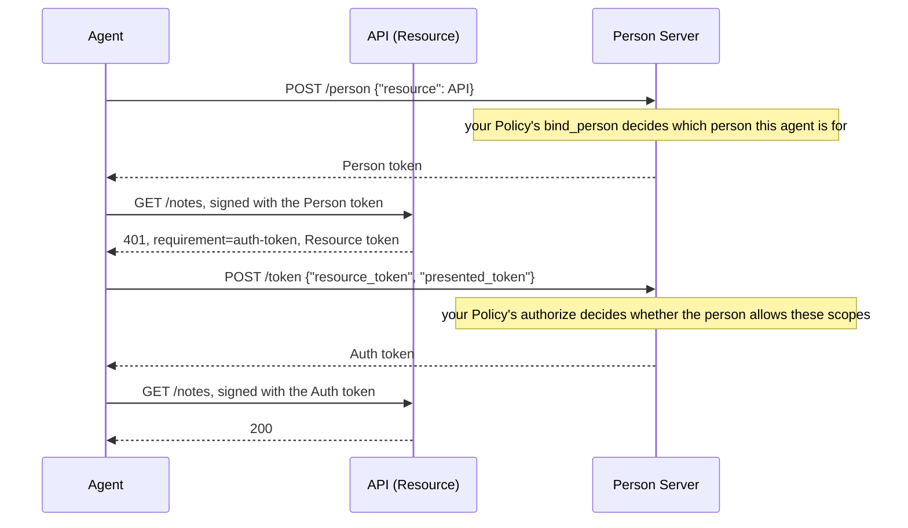

# Person Server

A Person Server represents a person to the rest of AAuth. It knows which person
each agent acts for, asks for that person's consent, and issues two kinds of
token:

- a **Person token**, which tells one Resource which person the agent acts
  for, under an identifier only that Resource sees, and grants nothing;
- an **Auth token**, which grants the agent scopes at one Resource, after your
  policy has decided the person allows it.

This crate is the protocol side: it checks every request and token, keeps the
records the protocol needs, and issues tokens. Your service decides who the
person is and what they allow.

Crate: `aauth-rust-person-server`. Terms are defined in
[How AAuth works](../how-aauth-works.md).

## Flow



## Smallest working code

This program runs the flow above in one process: an Agent Provider, a Person
Server, an API that requires a `notes.read` Auth token, and an agent. Each
server's keys are taken from the documents it publishes, as your service would
fetch them.

```rust
use aauth_rust_agent::{Agent, Requirement};
use aauth_rust_agent_provider::AgentProvider;
use aauth_rust_core::{
    AgentClaims, AgentKeyResolver, Confirmation, TokenError, TrustedIssuerKeys, VerifiedAuthToken,
};
use aauth_rust_jose::{Jwk, SigningKey};
use aauth_rust_person_server::{
    AuthorizationRequest, Config, Grant, MemoryStore, Person, PersonRequest, PersonServer, Policy,
    PolicyError,
};
use aauth_rust_resource::{PsAuthorizationConfig, PsAuthorizationResource};
use http::{Request, Response};
use serde_json::{Value, json};
use std::collections::BTreeMap;
use std::error::Error;
use std::sync::atomic::{AtomicU64, Ordering};
use std::sync::{Arc, RwLock};
use std::time::{SystemTime, UNIX_EPOCH};

const AP: &str = "https://ap.example";
const PS: &str = "https://ps.example";
const API: &str = "https://api.example";

/// Your decisions: who the person is, and what they allow.
struct People;
impl Policy for People {
    fn bind_person(&self, request: &PersonRequest) -> Result<Person, PolicyError> {
        // Look the agent up in your own accounts. Here one agent belongs to
        // one person.
        if request.agent.claims().sub != "aauth:assistant@ap.example" {
            return Err(PolicyError::Denied);
        }
        Ok(Person {
            id: "person-1".into(),      // your internal identifier, never published
            subject: "u-7f3c9a".into(), // what this Resource sees
            tenant: None,
        })
    }
    fn authorize(&self, request: &AuthorizationRequest) -> Result<Grant, PolicyError> {
        // The person has allowed reading notes, for ten minutes at a time.
        if request.scopes != ["notes.read"] {
            return Err(PolicyError::Denied);
        }
        Ok(Grant {
            scopes: request.scopes.clone(),
            lifetime: 600,
        })
    }
}

/// The servers this deployment trusts, keyed by identifier and metadata document.
#[derive(Clone, Default)]
struct Trust(Arc<RwLock<BTreeMap<(String, String), TrustedIssuerKeys>>>);
impl Trust {
    fn add(
        &self,
        issuer: &str,
        dwk: &str,
        metadata: &[u8],
        jwks: &[u8],
    ) -> Result<(), Box<dyn Error>> {
        let keys = TrustedIssuerKeys::from_documents(issuer, dwk, metadata, jwks)?;
        self.0
            .write()
            .unwrap()
            .insert((issuer.into(), dwk.into()), keys);
        Ok(())
    }
}
impl AgentKeyResolver for Trust {
    fn key(&self, issuer: &str, dwk: &str, kid: &str) -> Result<Jwk, TokenError> {
        let trusted = self.0.read().map_err(|_| TokenError::InvalidKey)?;
        let keys = trusted
            .get(&(issuer.into(), dwk.into()))
            .ok_or(TokenError::UntrustedIssuer)?;
        keys.key(issuer, dwk, kid)
    }
}

fn now() -> i64 {
    SystemTime::now()
        .duration_since(UNIX_EPOCH)
        .unwrap()
        .as_secs() as i64
}

fn get(uri: &str) -> Result<Request<Vec<u8>>, Box<dyn Error>> {
    Ok(Request::builder().uri(uri).body(Vec::new())?)
}

/// A signed JSON POST to the Person Server.
fn post(agent: &Agent, uri: &str, body: Value) -> Result<Request<Vec<u8>>, Box<dyn Error>> {
    let mut request = Request::builder()
        .method("POST")
        .uri(uri)
        .header("content-type", "application/json")
        .body(serde_json::to_vec(&body)?)?;
    agent.sign(&mut request, now())?;
    Ok(request)
}

/// The named token from a successful Person Server response.
fn token(response: Response<Vec<u8>>, name: &str) -> Result<String, Box<dyn Error>> {
    if response.status() != 200 {
        return Err(format!("refused: {}", String::from_utf8_lossy(response.body())).into());
    }
    let body: Value = serde_json::from_slice(response.body())?;
    Ok(body[name]
        .as_str()
        .ok_or("no token in the response")?
        .to_owned())
}

fn main() -> Result<(), Box<dyn Error>> {
    let trust = Trust::default();

    // The Agent Provider, and the agent it vouches for. The Agent token's
    // `ps` claim names the agent's Person Server.
    let provider = AgentProvider::new(AP, "ap-1", SigningKey::generate())?;
    trust.add(
        AP,
        "aauth-agent.json",
        &provider.metadata()?,
        &provider.jwks()?,
    )?;
    let key = SigningKey::generate();
    let agent_token = provider.issue(&AgentClaims {
        iss: AP.into(),
        dwk: "aauth-agent.json".into(),
        sub: "aauth:assistant@ap.example".into(),
        jti: "assistant-1".into(),
        iat: now(),
        exp: now() + 3600,
        cnf: Confirmation {
            jwk: key.public_jwk(),
        },
        ps: Some(PS.into()),
        parent_agent: None,
        nbf: None,
        extra: Default::default(),
    })?;
    let agent = Agent::new(key, agent_token)?;

    // The Person Server. MemoryStore keeps its records in memory only.
    let ids = AtomicU64::new(0);
    let ps = PersonServer::new(
        Config::new(PS, "ps-1", SigningKey::generate()),
        trust.clone(),
        MemoryStore::default(),
        People,
        now,
        move || format!("ps-{}", ids.fetch_add(1, Ordering::SeqCst)),
    )?;
    let metadata = ps.handle(&get(&format!("{PS}/.well-known/aauth-person.json"))?);
    let jwks = ps.handle(&get(&format!("{PS}/.well-known/jwks.json"))?);
    trust.add(PS, "aauth-person.json", metadata.body(), jwks.body())?;

    // The API: every request needs an Auth token with `notes.read`.
    let api = PsAuthorizationResource::new(
        PsAuthorizationConfig {
            issuer: API.into(),
            signed_origin: API.into(),
            kid: "api-1".into(),
            signing_key: SigningKey::generate(),
            scopes: vec!["notes.read".into()],
            scope_descriptions: BTreeMap::from([("notes.read".into(), "Read your notes".into())]),
        },
        trust.clone(),
        |_: &VerifiedAuthToken, _: &Request<Vec<u8>>| true,
    )?;
    trust.add(API, "aauth-resource.json", &api.metadata()?, &api.jwks()?)?;

    // 1. The agent asks its Person Server for a Person token for the API.
    let person = token(
        ps.handle(&post(
            &agent,
            &format!("{PS}/person"),
            json!({"resource": API}),
        )?),
        "person_token",
    )?;

    // 2. It calls the API with the Person token, and gets a Resource token back.
    let mut call = get(&format!("{API}/notes"))?;
    agent.with_token(person.clone())?.sign(&mut call, now())?;
    let challenge = api.authorize(&call, now(), "challenge-1").into_response();
    let Some(Requirement::AuthToken { resource_token }) =
        Requirement::from_headers(challenge.headers())?
    else {
        return Err("expected an auth-token requirement".into());
    };
    let resource =
        agent.verify_resource_challenge(&resource_token, API, PS, &person, &trust, now())?;

    // 3. It exchanges the Resource token and the Person token for an Auth token.
    let exchange = json!({"resource_token": resource_token, "presented_token": person});
    let auth = token(
        ps.handle(&post(&agent, &format!("{PS}/token"), exchange)?),
        "auth_token",
    )?;
    agent.verify_auth_delivery(&auth, API, &resource, &person, &trust, now())?;

    // 4. It calls the API with the Auth token, and the API's policy admits it.
    let mut call = get(&format!("{API}/notes"))?;
    agent.with_token(auth)?.sign(&mut call, now())?;
    let (granted, ()) = api
        .authorize(&call, now(), "challenge-2")
        .into_result()
        .map_err(|refusal| format!("refused with {}", refusal.status()))?;
    assert_eq!(granted.claims().scope.as_deref(), Some("notes.read"));
    assert_eq!(granted.claims().sub, "u-7f3c9a");
    Ok(())
}
```

## Endpoints

`PersonServer::handle` answers these paths at the configured origin:

| Method and path | Purpose |
| --- | --- |
| GET `/.well-known/aauth-person.json` | The metadata: issuer, JWKS location and endpoints |
| GET `/.well-known/jwks.json` | The public signing key |
| POST `/person` | Issue a Person token for one Resource |
| POST `/token` | Exchange a Resource token and a presented token for an Auth token |

The **presented token** is the Person token (or an earlier Auth token) the
agent signed its request to the Resource with; the Resource token names it,
and the agent sends both to `/token`.

Agents should take the endpoint URLs from the metadata
(`person_token_endpoint`, `auth_token_endpoint`). More endpoints appear when you
turn on the options below, and the metadata lists only the endpoints that are
on. The library is synchronous; in an async server, call `handle` on a
blocking worker.

## What your service supplies

- **`Policy::bind_person`**: which person the agent acts for. Decide from
  evidence you already hold: an agent the person linked to their account, or a
  claim from an Agent Provider you have an agreement with. Never from
  `login_hint` or other request parameters; the agent wrote those. Return
  `Person` with your internal `id`, a `subject` for this Resource, stable and
  different for each Resource, and an optional `tenant`, the organization the
  person belongs to. The Person Server records the agent's **binding** to that
  person and holds it from then on; `request.enrolls_agent()` is true the first
  time.
- **`Policy::authorize`**: return the scopes the person allows, a non-empty
  subset of those requested, and a lifetime of at most 3600 seconds, or
  `PolicyError::Denied`.
- **Trust**: a [resolver](../how-aauth-works.md#what-the-library-leaves-to-you)
  for the Agent Providers and Resources you accept, built from their published
  documents, as `Trust` above. `KeyResolver` in `aauth-rust-discovery` fetches
  and caches those documents for you; see
  [Discovery and revocation delivery](../discovery.md).
- **A store** for issued tokens and person bindings. `MemoryStore` loses
  everything on restart. `aauth-rust-person-server-redb` stores them in a file
  on Unix; see
  [Durable Person Server storage](../../USE-IN-YOUR-SERVICE.md#durable-person-server-storage).
  A store of your own must pass `storetest::check_store_contract`.
- **A clock** in Unix seconds, and **token IDs** unique across restarts.
- **Sign-in and consent, ahead of time.** The person signs in and gives
  consent on your own pages, outside these requests: the Person Server cannot
  pause a `/person` or `/token` request to send the person to a sign-in page.
  If your policy cannot decide from what you already know, refuse with
  `PolicyError::Denied`, or with `PolicyError::UserUnreachable`, which the
  agent receives as `403 user_unreachable`.

The Person Server checks the agent's signature, the Agent token, the Resource
token and the presented token before your policy runs, and keeps the record of
each token it issues before releasing it. It accepts a presented token only if
it holds that token's record, so keep the store when you restart.

## Options

| Call | Adds | Guide |
| --- | --- | --- |
| `with_federation(adapter)` | Auth tokens from a Resource's own Access Server | [Access Server](access-server.md) |
| `with_deferred(config)` | Deferred (`202`) answers while an Access Server waits for approval or payment | [Deferred answers at the Access Server and Person Server](../../USE-IN-YOUR-SERVICE.md#configure-as-and-ps-continuations) |
| `with_missions()` | Mission proposal, approval, update and completion | [Missions](../features/missions.md) |
| `with_governance(governance)` | Endpoints where the agent asks the person's permission and records what it did | [Missions](../features/missions.md) |
| `with_interaction_relay(config)` | Relays an agent's interaction or payment to the person through your channel | [Relay an agent's interaction to the person](../../USE-IN-YOUR-SERVICE.md#relay-an-agents-interaction-to-the-person) |
| `with_supervision(config)` | A supervision server decides for the agents you assign to it | [Supervision](../features/supervision.md) |
| `with_r3(...)` | Auth tokens for R3 documents | [R3](../features/r3.md) |
| `with_budgets(...)` | Budgets on Auth tokens | [Budgets](../features/budgets.md) |
| `with_revocation()` | A revocation endpoint; revoking a token also revokes the tokens obtained with it | [Make an immediate downstream call](../../USE-IN-YOUR-SERVICE.md#make-an-immediate-downstream-call) |
| `with_revocation_directory(directory)` | Delivery of those revocations to each Resource and Access Server; `RevocationClient` sends them over HTTPS | [Discovery and revocation delivery](../discovery.md) |
| `with_resource_interaction(config)` | A Resource's own sign-in step before consent | [Resolve a Resource's own interaction](../../USE-IN-YOUR-SERVICE.md#resolve-a-resources-own-interaction) |

`Policy::bind_upstream` and `Policy::authorize_upstream` serve
[call chaining](../features/call-chaining.md). They refuse unless you
implement them.

## Next

- [Errors](../errors.md): the codes `/person` and `/token` return.
- [Run a Person Server](../../USE-IN-YOUR-SERVICE.md#run-a-person-server): the
  full reference.
- The three-party example runs this flow over TLS, with one API calling
  another: `cargo run --locked -p aauth-rust-resource --example three-party`.
