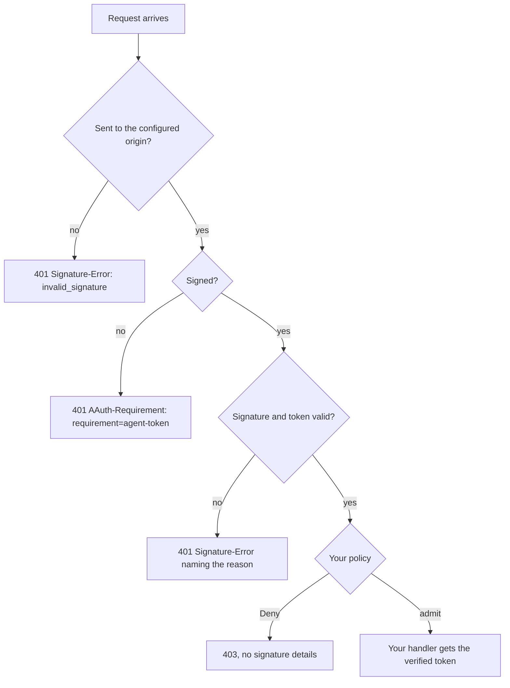

# Resource

A Resource is the API an agent calls. This crate checks each request before
your handler runs: that it was sent to your origin, that the signature and the
token are valid, and then what your policy says. It hands your handler the
verified token, or gives you the refusal to send.

There are two checks to choose from:

- `AgentIdentityResource` decides from the agent's identity alone: which agent
  is calling, vouched for by its Agent Provider.
- `PsAuthorizationResource` requires an Auth token: a person's consent from
  their Person Server (`new`), or a decision from your own Access Server
  (`new_federated`).

Crate: `aauth-rust-resource`. Terms are defined in
[How AAuth works](../how-aauth-works.md).

## Flow



`PsAuthorizationResource` asks for more. An unsigned request is answered
`401` with `requirement=person-token`. A request signed with a valid Person
token is answered `401` with `requirement=auth-token` and a Resource token,
which the agent exchanges for an Auth token. Only a request signed with a
valid Auth token reaches your policy. [Person Server](person-server.md) runs
that flow.

## Smallest working code

The policy admits one agent and tells the handler which plan it is on. The
program sends two requests in the same process: one unsigned, one signed.

```rust
use aauth_rust_agent::Agent;
use aauth_rust_agent_provider::AgentProvider;
use aauth_rust_core::{AgentClaims, AgentProviderKeys, Confirmation, VerifiedAgentToken};
use aauth_rust_jose::SigningKey;
use aauth_rust_resource::{AgentIdentityResource, Deny};
use http::{Request, Response};
use std::time::{SystemTime, UNIX_EPOCH};

/// What the policy tells the handler about an admitted agent.
struct Caller {
    plan: &'static str,
}

fn now() -> i64 {
    SystemTime::now()
        .duration_since(UNIX_EPOCH)
        .unwrap()
        .as_secs() as i64
}

fn main() -> Result<(), Box<dyn std::error::Error>> {
    // The Agent Provider you trust, and its published documents. Your service
    // fetches these over HTTPS; here the provider is in the same process.
    let provider = AgentProvider::new("https://ap.example", "ap-key-1", SigningKey::generate())?;
    let keys = AgentProviderKeys::from_documents(
        "https://ap.example",
        &provider.metadata()?,
        &provider.jwks()?,
    )?;

    // Check every request to this origin; the policy runs after the checks.
    let api = AgentIdentityResource::for_origin(
        "https://api.example",
        keys,
        |agent: &VerifiedAgentToken, _: &Request<Vec<u8>>| -> Result<Caller, Deny> {
            match agent.claims().sub.as_str() {
                "aauth:assistant@ap.example" => Ok(Caller { plan: "team" }),
                _ => Err(Deny),
            }
        },
    )?;

    // Your handler.
    let handle = |request: Request<Vec<u8>>| -> Response<Vec<u8>> {
        match api.authorize(&request, now()).into_result() {
            Ok((agent, caller)) => {
                let body = format!("{} is on the {} plan", agent.claims().sub, caller.plan);
                Response::new(body.into_bytes())
            }
            Err(refusal) => *refusal,
        }
    };

    // Publish this at https://api.example/.well-known/aauth-resource.json.
    let _metadata = api.metadata()?;

    // An unsigned request is told what to send.
    let unsigned = Request::builder()
        .uri("https://api.example/notes")
        .body(Vec::new())?;
    let response = handle(unsigned);
    assert_eq!(response.status(), 401);
    assert_eq!(
        response.headers()["aauth-requirement"],
        "requirement=agent-token"
    );

    // A signed request from the admitted agent reaches the handler.
    let key = SigningKey::generate();
    let token = provider.issue(&AgentClaims {
        iss: "https://ap.example".into(),
        dwk: "aauth-agent.json".into(),
        sub: "aauth:assistant@ap.example".into(),
        jti: "assistant-1".into(),
        iat: now(),
        exp: now() + 600,
        cnf: Confirmation {
            jwk: key.public_jwk(),
        },
        ps: None,
        parent_agent: None,
        nbf: None,
        extra: Default::default(),
    })?;
    let agent = Agent::new(key, token)?;
    let mut signed = Request::builder()
        .uri("https://api.example/notes")
        .body(Vec::new())?;
    agent.sign(&mut signed, now())?;
    let response = handle(signed);
    assert_eq!(response.status(), 200);
    assert_eq!(
        response.body(),
        b"aauth:assistant@ap.example is on the team plan"
    );
    Ok(())
}
```

## Requests from your web framework

The check takes an `http::Request<Vec<u8>>`. To build one from your framework's
request:

- Use the absolute `https` URL of your own configured origin and the request's
  path and query. Never build it from the client's `Host` header. A request for
  another origin is refused before your policy runs, even with a valid
  signature.
- Keep the method and the headers as received.
- Read the whole body, with a limit, before checking. The library refuses a
  body over 1 MiB. Check the body before you decompress it.
- If TLS ends at a proxy in front of your service, make sure the proxy passes
  the method, path, query, body, `Content-Type` and `Content-Digest` through
  unchanged.

The `axum` example does this:
`cargo run --locked -p aauth-rust-resource --example axum`. Its adapter is
[`examples/framework/mod.rs`](../../crates/aauth-rust-resource/examples/framework/mod.rs).

`AgentIdentityResource::new(endpoint, ...)` accepts one exact URL;
`for_origin(origin, ...)` accepts any path on that origin, and your router
decides which paths exist.

## Decisions and responses

`authorize` returns a decision. `into_result()` gives your handler the
verified token and the value your policy returned, or the response to send.
`into_response()` maps every case to a response; on success it only writes the
agent identifier as the body.

| `AgentIdentityResource` decision | Response |
| --- | --- |
| `AgentTokenRequired` | 401, `AAuth-Requirement: requirement=agent-token` |
| `SignatureFailure(failure)` | 401, `Signature-Error: error=<failure.code()>` |
| `Forbidden` | 403, with no signature details |
| `Granted(authorized)` | your handler |
| `OtherScheme(proof)` | only after `with_further_schemes`; see [Serve clients outside AAuth](../../USE-IN-YOUR-SERVICE.md#serve-clients-outside-aauth) |

| `PsAuthorizationResource` decision | Response |
| --- | --- |
| `PersonTokenRequired` | 401, `requirement=person-token` |
| `AuthTokenRequired { resource_token, .. }` | 401, `requirement=auth-token` with the Resource token |
| `SignatureFailure(failure)` | 401, `Signature-Error` |
| `Revoked { .. }` | 401, `Signature-Error: error=revoked_jwt` |
| `Forbidden { .. }` | 403, `access_denied` |
| `Granted(authorized)` | your handler |

The policy can return `bool`, or `Result<T, Deny>` to hand a value to your
handler. Failures carry an `application/problem+json` body.
[Errors](../errors.md) lists every code.

## Asking for an Auth token

`PsAuthorizationResource::new(config, keys, policy)` takes:

- `issuer`, your published server identifier, and `signed_origin`, the origin
  requests are sent to (they differ only when you listen on another port);
- `kid` and `signing_key`, which sign your Resource tokens;
- `scopes`, the scopes every route behind this value requires, and
  `scope_descriptions`, a description of each one that your metadata
  publishes;
- `keys`, which must resolve the Person Servers you trust
  (`aauth-person.json`), or your Access Server (`aauth-access.json`) for
  `new_federated`.

Serve `metadata()` and `jwks()` at `/.well-known/aauth-resource.json` and
`/.well-known/jwks.json`. Call `authorize(&request, now, challenge_id)` with a
fresh unique `challenge_id` for each request. One value requires one fixed set
of scopes; use another value for routes that need other scopes. An Auth token
that grants only some of the configured scopes is refused with `403`.

Options, each described in its guide: `with_mission_context`
([Missions](../features/missions.md)), `with_budgets`
([Budgets](../features/budgets.md)), `with_r3` and `with_r3_per_call`
([R3](../features/r3.md)), and `with_authorization_endpoint`, which serves
`POST /authorize` so an agent can ask for a Resource token before it calls.

## What your service supplies

- The Agent Providers, Person Servers and Access Servers you trust, and their
  keys, fetched by you and refreshed when an `UnknownKey` error says a key is
  missing.
- Your signing key, for `PsAuthorizationResource`.
- **Protection against repeats.** A signed request is accepted again if it is
  replayed within its 60-second window. For a request that changes something,
  use an idempotency key of your own. See
  [Replay and application effects](../../USE-IN-YOUR-SERVICE.md#replay-and-application-effects).

## Next

- [Person Server](person-server.md): the three-party exchange, end to end.
- [Protect a Resource with PS authorization](../../USE-IN-YOUR-SERVICE.md#protect-a-resource-with-ps-authorization)
  and [Adapt framework requests](../../USE-IN-YOUR-SERVICE.md#adapt-framework-requests):
  the details.
