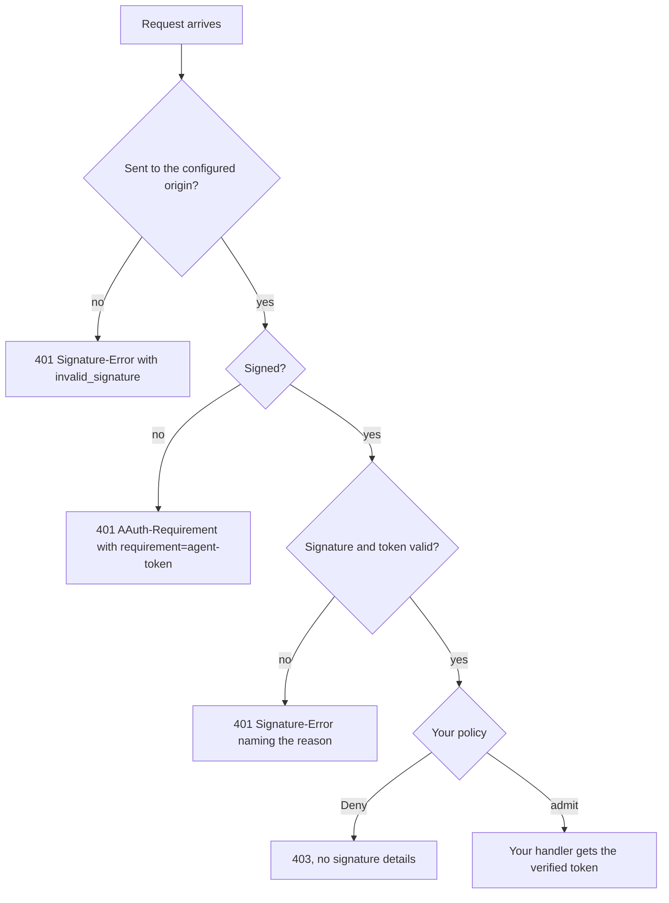

# Resource

A Resource is the API an agent calls. This crate checks each request before
your handler runs: that it was sent to your origin, that the signature and the
token are valid, and then what your policy says. It hands your handler the
verified token, or gives you the refusal to send.

There are three checks to choose from:

- `AgentIdentityResource` decides from the agent's identity alone: which agent
  is calling, vouched for by its Agent Provider.
- `PersonIdentityResource` decides from the person the agent acts for, named
  by a Person token from their Person Server.
- `PsAuthorizationResource` requires an Auth token: a person's consent from
  their Person Server (`new`), or a decision from your own Access Server
  (`new_federated`).

Crate: `aauth-rust-resource`. Terms are defined in
[How AAuth works](../how-aauth-works.md).

## Flow



`PsAuthorizationResource` asks for more. An unsigned request is answered
`401` with `requirement=person-token`. A request signed with a valid Person
token is answered `401` with `requirement=auth-token` and a Resource token,
which the agent exchanges for an Auth token. Only a request signed with a
valid Auth token reaches your policy. [Person Server](person-server.md) runs
that flow.

## Smallest working code

The policy admits one agent and tells the handler which plan it is on. The
program sends two requests in the same process: one unsigned, one signed.

```rust
use aauth_rust_agent::Agent;
use aauth_rust_agent_provider::AgentProvider;
use aauth_rust_core::{AgentClaims, AgentProviderKeys, Confirmation, VerifiedAgentToken};
use aauth_rust_jose::SigningKey;
use aauth_rust_resource::{AgentIdentityResource, Deny};
use http::{HeaderValue, Request, Response};
use std::time::{SystemTime, UNIX_EPOCH};

/// What the policy tells the handler about an admitted agent.
struct Caller {
    plan: &'static str,
}

fn now() -> i64 {
    SystemTime::now()
        .duration_since(UNIX_EPOCH)
        .unwrap()
        .as_secs() as i64
}

fn main() -> Result<(), Box<dyn std::error::Error>> {
    // The Agent Provider you trust, and its published documents. Your service
    // fetches these over HTTPS; here the provider is in the same process.
    let provider = AgentProvider::new("https://ap.example", "ap-key-1", SigningKey::generate())?;
    let keys = AgentProviderKeys::from_documents(
        "https://ap.example",
        &provider.metadata()?,
        &provider.jwks()?,
    )?;

    // Check every request to this origin; the policy runs after the checks.
    let api = AgentIdentityResource::for_origin(
        "https://api.example",
        keys,
        |agent: &VerifiedAgentToken, _: &Request<Vec<u8>>| -> Result<Caller, Deny> {
            match agent.claims().sub.as_str() {
                "aauth:assistant@ap.example" => Ok(Caller { plan: "team" }),
                _ => Err(Deny),
            }
        },
    )?;

    // Your handler. It also serves the API's metadata, which some clients,
    // such as aauth-go's, read before calling.
    let metadata = api.metadata()?;
    let handle = |request: Request<Vec<u8>>| -> Response<Vec<u8>> {
        if request.uri().path() == "/.well-known/aauth-resource.json" {
            let mut response = Response::new(metadata.clone());
            let json = HeaderValue::from_static("application/json");
            response.headers_mut().insert("content-type", json);
            return response;
        }
        match api.authorize(&request, now()).into_result() {
            Ok((agent, caller)) => {
                let body = format!("{} is on the {} plan", agent.claims().sub, caller.plan);
                Response::new(body.into_bytes())
            }
            Err(refusal) => *refusal,
        }
    };

    // Anyone can read the metadata.
    let get = Request::builder()
        .uri("https://api.example/.well-known/aauth-resource.json")
        .body(Vec::new())?;
    assert_eq!(handle(get).status(), 200);

    // An unsigned request is told what to send.
    let unsigned = Request::builder()
        .uri("https://api.example/notes")
        .body(Vec::new())?;
    let response = handle(unsigned);
    assert_eq!(response.status(), 401);
    assert_eq!(
        response.headers()["aauth-requirement"],
        "requirement=agent-token"
    );

    // A signed request from the admitted agent reaches the handler.
    let key = SigningKey::generate();
    let token = provider.issue(&AgentClaims {
        iss: "https://ap.example".into(),
        dwk: "aauth-agent.json".into(),
        sub: "aauth:assistant@ap.example".into(),
        jti: "assistant-1".into(),
        iat: now(),
        exp: now() + 600,
        cnf: Confirmation {
            jwk: key.public_jwk(),
        },
        ps: None,
        parent_agent: None,
        nbf: None,
        extra: Default::default(),
    })?;
    let agent = Agent::new(key, token)?;
    let mut signed = Request::builder()
        .uri("https://api.example/notes")
        .body(Vec::new())?;
    agent.sign(&mut signed, now())?;
    let response = handle(signed);
    assert_eq!(response.status(), 200);
    assert_eq!(
        response.body(),
        b"aauth:assistant@ap.example is on the team plan"
    );
    Ok(())
}
```

## Requests from your web framework

The check takes an `http::Request<Vec<u8>>`. To build one from your framework's
request:

- Use the absolute `https` URL of your own configured origin and the request's
  path and query. Never build it from the client's `Host` header. A request for
  another origin is refused before your policy runs, even with a valid
  signature.
- Keep the method and the headers as received.
- Read the whole body, with a limit, before checking. The library refuses a
  body over 1 MiB. Pass the body as it arrived, still compressed if it was
  sent compressed: `Content-Digest` covers those bytes.
- If TLS ends at a proxy in front of your service, make sure the proxy passes
  the method, path, query, body, `Content-Type` and `Content-Digest` through
  unchanged.

- Serve `metadata()` at `/.well-known/aauth-resource.json`. The library does
  not route it for you.

- If every request must also sign a header of yours, such as `x-tenant`, build
  the Resource `with_additional_signature_components(["x-tenant"])`. The
  metadata then lists it as `additional_signature_components`, and a request
  that does not sign it is refused with `invalid_input`, whose `required_input`
  names it. A Rust agent signs it after `Agent::with_resource_metadata`, or
  after `Agent::with_required_input` on that refusal.

The `axum` example does all of this:
`cargo run --locked -p aauth-rust-resource --example axum`. Its adapter is
[`examples/framework/mod.rs`](../../crates/aauth-rust-resource/examples/framework/mod.rs).
To start your own axum service from it, run these commands from inside a
checkout of the repository. They create `../aauth-axum-service` with the
example as its `src/main.rs`, the adapter beside it, and the crates.io
dependencies it needs, then run it:

<!-- checked: axum-project -->
```sh
(
set -eu
mkdir ../aauth-axum-service ../aauth-axum-service/src ../aauth-axum-service/src/framework
cp crates/aauth-rust-resource/examples/axum.rs ../aauth-axum-service/src/main.rs
cp crates/aauth-rust-resource/examples/framework/mod.rs ../aauth-axum-service/src/framework/
cat > ../aauth-axum-service/Cargo.toml <<'TOML'
[package]
name = "aauth-axum-service"
version = "0.1.0"
edition = "2024"
rust-version = "1.99"
publish = false

[workspace]

[dependencies]
aauth-rust-agent = "0.1.0-alpha.27"
aauth-rust-agent-provider = "0.1.0-alpha.27"
aauth-rust-core = "0.1.0-alpha.27"
aauth-rust-jose = "0.1.0-alpha.27"
aauth-rust-resource = "0.1.0-alpha.27"
axum = { version = "0.8", default-features = false, features = ["http1", "tokio"] }
http = "1"
hyper-util = { version = "0.1", default-features = false, features = ["client", "client-legacy", "http1", "tokio"] }
serde_json = "1"
tokio = { version = "1", features = ["macros", "rt-multi-thread", "net", "sync", "time"] }
TOML
cd ../aauth-axum-service
cargo generate-lockfile
cargo run --locked
)
```

`hyper-util` is there only because the example calls its own server as a
client; your service may not need it.

`AgentIdentityResource::new(endpoint, ...)` accepts one exact URL;
`for_origin(origin, ...)` accepts any path on that origin, and your router
decides which paths exist.

## Trusting several Agent Providers

`AgentProviderKeys` holds the keys of one Agent Provider. To accept agents
from several, give the Resource a resolver that looks up each provider's keys
by its identifier. With documents you already hold, it is a few lines, below.
`KeyResolver` in `aauth-rust-discovery` is the same resolver with the fetching
and caching done for you; see
[Discovery and revocation delivery](../discovery.md).

```rust
use aauth_rust_agent::Agent;
use aauth_rust_agent_provider::AgentProvider;
use aauth_rust_core::{
    AgentClaims, AgentKeyResolver, Confirmation, TokenError, TrustedIssuerKeys, VerifiedAgentToken,
};
use aauth_rust_jose::{Jwk, SigningKey};
use aauth_rust_resource::AgentIdentityResource;
use http::Request;
use std::collections::BTreeMap;
use std::error::Error;
use std::time::{SystemTime, UNIX_EPOCH};

/// The Agent Providers this API trusts, by server identifier.
#[derive(Default)]
struct Providers(BTreeMap<String, TrustedIssuerKeys>);
impl Providers {
    /// Trust one more provider, from its metadata and JWKS documents.
    fn add(&mut self, issuer: &str, metadata: &[u8], jwks: &[u8]) -> Result<(), TokenError> {
        let keys = TrustedIssuerKeys::from_documents(issuer, "aauth-agent.json", metadata, jwks)?;
        self.0.insert(issuer.into(), keys);
        Ok(())
    }
}
impl AgentKeyResolver for Providers {
    fn key(&self, issuer: &str, dwk: &str, kid: &str) -> Result<Jwk, TokenError> {
        let keys = self.0.get(issuer).ok_or(TokenError::UntrustedIssuer)?;
        keys.key(issuer, dwk, kid)
    }
}

fn now() -> i64 {
    SystemTime::now()
        .duration_since(UNIX_EPOCH)
        .unwrap()
        .as_secs() as i64
}

/// A signed GET from a new agent of `provider`.
fn call(provider: &AgentProvider, issuer: &str) -> Result<Request<Vec<u8>>, Box<dyn Error>> {
    let key = SigningKey::generate();
    let host = issuer.trim_start_matches("https://");
    let token = provider.issue(&AgentClaims {
        iss: issuer.into(),
        dwk: "aauth-agent.json".into(),
        sub: format!("aauth:assistant@{host}"),
        jti: format!("assistant-{host}"),
        iat: now(),
        exp: now() + 600,
        cnf: Confirmation {
            jwk: key.public_jwk(),
        },
        ps: None,
        parent_agent: None,
        nbf: None,
        extra: Default::default(),
    })?;
    let mut request = Request::builder()
        .uri("https://api.example/notes")
        .body(Vec::new())?;
    Agent::new(key, token)?.sign(&mut request, now())?;
    Ok(request)
}

fn main() -> Result<(), Box<dyn Error>> {
    let one = AgentProvider::new("https://ap-one.example", "one-1", SigningKey::generate())?;
    let two = AgentProvider::new("https://ap-two.example", "two-1", SigningKey::generate())?;
    let other = AgentProvider::new(
        "https://ap-other.example",
        "other-1",
        SigningKey::generate(),
    )?;

    // Your service fetched these documents from each provider it trusts.
    let mut providers = Providers::default();
    providers.add("https://ap-one.example", &one.metadata()?, &one.jwks()?)?;
    providers.add("https://ap-two.example", &two.metadata()?, &two.jwks()?)?;

    let api = AgentIdentityResource::for_origin(
        "https://api.example",
        providers,
        |_: &VerifiedAgentToken, _: &Request<Vec<u8>>| true,
    )?;
    let status =
        |request: Request<Vec<u8>>| api.authorize(&request, now()).into_response().status();
    assert_eq!(status(call(&one, "https://ap-one.example")?), 200);
    assert_eq!(status(call(&two, "https://ap-two.example")?), 200);
    // A provider you have not added is refused: 401, Signature-Error invalid_key.
    assert_eq!(status(call(&other, "https://ap-other.example")?), 401);
    Ok(())
}
```

The same pattern trusts Person Servers (`aauth-person.json`) and Access
Servers (`aauth-access.json`): key the map by identifier and metadata document,
as the `Trust` type in the [Person Server](person-server.md) guide does. To
change a provider's keys, rebuild its entry from fresh documents.

## What your handler receives

`into_result()` gives your handler the verified token and your policy's value.
The token's `claims()` are already checked; `compact()` is the token exactly as
it arrived.

From `AgentIdentityResource`, a `VerifiedAgentToken` whose `claims()` is an
`AgentClaims`:

| Field | Type | Meaning |
| --- | --- | --- |
| `iss` | `String` | The Agent Provider |
| `sub` | `String` | The agent identifier, `aauth:name@domain` |
| `ps` | `Option<String>` | The agent's Person Server, if it named one |
| `parent_agent` | `Option<String>` | For a sub-agent, its parent agent |
| `jti`, `iat`, `exp`, `nbf` | `String`, `i64`, `i64`, `Option<i64>` | Token ID and times, in Unix seconds |
| `cnf` | `Confirmation` | The agent's public key, `cnf.jwk` |
| `extra` | `BTreeMap<String, Value>` | Any other claims the provider added |

From `PsAuthorizationResource`, a `VerifiedAuthToken` whose `claims()` is an
`AuthClaims`. It names the person, not the agent: an Auth token carries no
agent identifier.

| Field | Type | Meaning |
| --- | --- | --- |
| `sub` | `String` | The person, as an identifier only this Resource sees |
| `ps` | `String` | The person's Person Server; `sub` is unique within it |
| `scope` | `Option<String>` | The granted scopes, separated by spaces |
| `iss` | `String` | Who issued the token: the Person Server, or your Access Server |
| `aud` | `String` | This Resource |
| `tenant` | `Option<String>` | The person's organization, if given |
| `account` | `Option<String>` | The account, if your Resource token asked for one |
| `mission_s256` | `Option<String>` | The mission, with `with_mission_context` |
| `jti`, `iat`, `exp`, `nbf` | `String`, `i64`, `i64`, `Option<i64>` | Token ID and times |
| `cnf` | `Confirmation` | The agent's public key |
| `extra` | `BTreeMap<String, Value>` | Other claims, such as `budget` |

To act per person, key your data on the pair `(ps, sub)`.

## Decisions and responses

`authorize` returns a decision. `into_result()` gives your handler the
verified token and the value your policy returned, or the response to send.
`into_response()` maps every case to a response; on success it only writes the
agent identifier as the body.

| `AgentIdentityResource` decision | Response |
| --- | --- |
| `AgentTokenRequired` | 401, `AAuth-Requirement: requirement=agent-token` |
| `SignatureFailure(failure)` | 401, `Signature-Error: error=<failure.code()>` |
| `Forbidden` | 403, with no signature details |
| `Granted(authorized)` | your handler |
| `OtherScheme(proof)` | only after `with_further_schemes`; see [Serve clients outside AAuth](../../USE-IN-YOUR-SERVICE.md#serve-clients-outside-aauth) |

| `PsAuthorizationResource` decision | Response |
| --- | --- |
| `PersonTokenRequired` | 401, `requirement=person-token` |
| `AuthTokenRequired { resource_token, .. }` | 401, `requirement=auth-token` with the Resource token |
| `SignatureFailure(failure)` | 401, `Signature-Error` |
| `Revoked { .. }` | 401, `Signature-Error: error=revoked_jwt` |
| `Forbidden { .. }` | 403, `access_denied` |
| `Granted(authorized)` | your handler |

The policy can return `bool`, or `Result<T, Deny>` to hand a value to your
handler. Failures carry an `application/problem+json` body.
[Errors](../errors.md) lists every code.

## Serving on the person's identity

`PersonIdentityResource::new(endpoint, keys, policy)` serves one endpoint to
whoever the person is, without consent or scopes; `for_origin` binds every
path of an origin, as for `AgentIdentityResource`. `keys` resolves the public
keys of the Person Servers you trust, read from each one's
`aauth-person.json`. Serve `metadata()` at `/.well-known/aauth-resource.json`:
it declares `access_mode` `person-token`, and `with_display` adds your name
and description. `authorize(&request, now)` returns a `PersonDecision`:

| Decision | Response |
| --- | --- |
| `PersonTokenRequired` | 401, `requirement=person-token`, for a request with no Person token |
| `SignatureFailure` | 401 with `Signature-Error` |
| `Forbidden` | 403, your policy refused the person |
| `Granted` | your handler gets the verified Person token |

The agent then gets a Person token for your origin from its Person Server and
signs again with it. Your policy receives the verified token: its `sub` and
`iss` name the person, as for an Auth token. The Person Server is not called.

## Asking for an Auth token

`PsAuthorizationResource::new(config, keys, policy)` takes:

- `issuer`, the server identifier you publish, such as `https://api.example`,
  and `signed_origin`, the origin requests are sent to. They differ only when
  the origin has a port, such as `https://api.example:8443`;
- `kid` and `signing_key`, which sign your Resource tokens;
- `scopes`, the scopes every route behind this value requires, and
  `scope_descriptions`, a description of each one that your metadata
  publishes;
- `keys`, a resolver for the public keys of the Person Servers you trust,
  read from each one's `aauth-person.json`, or of your Access Server, from its
  `aauth-access.json`, for `new_federated`.

Serve `metadata()` and `jwks()` at `/.well-known/aauth-resource.json` and
`/.well-known/jwks.json`. Call `authorize(&request, now, challenge_id)` with a
new unique `challenge_id` for each request: it becomes the ID of the Resource
token, if one is issued. Each `PsAuthorizationResource` requires one fixed set
of scopes; make one for each set your routes need. An Auth token that grants
only some of them is refused with `403`.

Options, each described in its guide: `with_mission_context`
([Missions](../features/missions.md)), `with_budgets`
([Budgets](../features/budgets.md)), `with_r3` and `with_r3_per_call`
([R3](../features/r3.md)), and `with_authorization_endpoint`, which serves
`POST /authorize` so an agent can ask for a Resource token before it calls.

## What your service supplies

- The Agent Providers, Person Servers and Access Servers you trust, and their
  keys, which you fetch, and refresh when an `UnknownKey` error says a key is
  missing or a signature fails under a key you hold
  (`AgentKeyResolver::refreshed_key`), or which `KeyResolver` fetches and
  refreshes for you.
- With `with_revocation_directory`, the delivery of the Resource-token
  revocations `revoke_issued_resource_token` cascades; `RevocationClient`
  sends them over HTTPS.
- Your signing key, for `PsAuthorizationResource`.
- **Protection against repeats.** A signed request is accepted again if it is
  replayed within its 60-second window. For a request that changes something,
  use an idempotency key of your own. See
  [Replay and application effects](../../USE-IN-YOUR-SERVICE.md#replay-and-application-effects).

## Next

- [Person Server](person-server.md): the three-party exchange, end to end.
- [Protect a Resource with PS authorization](../../USE-IN-YOUR-SERVICE.md#protect-a-resource-with-ps-authorization)
  and [Adapt framework requests](../../USE-IN-YOUR-SERVICE.md#adapt-framework-requests):
  the details.
