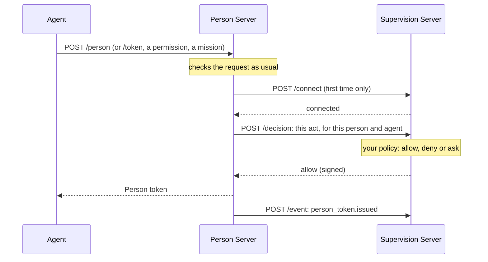

# Supervision Server

A supervision server approves or refuses an agent's requests for the person.
A person with many agents, or an organization that governs its members'
agents, registers one with the Person Server and assigns agents to it. For each
assigned agent, the Person Server asks the server before it issues a Person or
Auth token, grants a permission, or accepts a mission proposal, update or
completion. The draft calls each of these requests an **act**. The server
answers `allow`, `deny` or `ask` (put it to the person), or asks the agent a
question first. Afterwards the Person Server reports to it what happened.

The server issues no tokens and calls no one: everything it says is a response
to the Person Server. With a signing key it signs every final answer, so the
Person Server's record shows who decided what.

Crate: `aauth-rust-supervision-server` for the server, and
`PersonServer::with_supervision` in `aauth-rust-person-server` for the Person
Server's side. The draft is `draft-hardt-aauth-supervision`. Terms are defined
in [How AAuth works](../how-aauth-works.md).

## Flow



When the answer is `ask`, or the server cannot be reached, the Person Server
answers the agent `202` and keeps the request pending while your service asks
the person.

## Smallest working code

This program routes two agents to one supervision server, in one process. The
server's policy lets the assistant get Person tokens and refuses the intern.

```rust
use aauth_rust_agent::Agent;
use aauth_rust_agent_provider::AgentProvider;
use aauth_rust_core::continuation::MemoryContinuations;
use aauth_rust_core::supervision::{Act, Allowance};
use aauth_rust_core::{AgentClaims, AgentKeyResolver, Confirmation, TokenError, TrustedIssuerKeys};
use aauth_rust_jose::{Jwk, SigningKey};
use aauth_rust_person_server::{
    AgentIdentity, AuthorizationRequest, Config, Grant, MemoryStore, Person, PersonRequest,
    PersonServer, Policy, PolicyError, Supervision, SupervisionConfig, SupervisionUnavailable,
};
use aauth_rust_supervision_server as supervision;
use http::{Request, Response};
use serde_json::json;
use std::collections::BTreeMap;
use std::error::Error;
use std::sync::atomic::{AtomicU64, Ordering};
use std::sync::{Arc, RwLock};
use std::time::{SystemTime, UNIX_EPOCH};

const AP: &str = "https://ap.example";
const PS: &str = "https://ps.example";
const SS: &str = "https://ss.example";
const API: &str = "https://api.example";

/// The supervision server's policy.
struct Standing;
impl supervision::Policy for Standing {
    fn connect(&self, _: &supervision::ConnectRequest) -> supervision::ConnectAnswer {
        supervision::ConnectAnswer::Connected
    }
    fn decide(&self, case: &supervision::Case) -> supervision::Verdict {
        match (case.act, case.agent.as_str()) {
            (Act::PersonToken, "aauth:assistant@ap.example") => {
                supervision::Verdict::Allow(Allowance::default())
            }
            _ => supervision::Verdict::Deny(Some("Not for this agent.".into())),
        }
    }
}

/// The Person Server still says which person an agent acts for. For an agent
/// assigned to a supervision server, `authorize` is not called.
struct People;
impl Policy for People {
    fn bind_person(&self, _: &PersonRequest) -> Result<Person, PolicyError> {
        Ok(Person {
            id: "person-1".into(),
            subject: "u-7f3c9a".into(),
            tenant: None,
        })
    }
    fn authorize(&self, _: &AuthorizationRequest) -> Result<Grant, PolicyError> {
        Err(PolicyError::Denied)
    }
}

/// How the Person Server routes agents and reaches supervision servers. Yours
/// reads the person's settings, fetches metadata and sends over HTTPS.
struct Router {
    metadata: Vec<u8>,
    send: Box<dyn Fn(&Request<Vec<u8>>) -> Response<Vec<u8>> + Send + Sync>,
}
impl Supervision for Router {
    fn route(&self, _person_id: &str, _agent: &AgentIdentity) -> Option<String> {
        Some(SS.into())
    }
    fn subject(&self, _person_id: &str, _supervisor: &str) -> String {
        // The person's identifier for this server, like a Resource's subject.
        "s-41d2c8".into()
    }
    fn metadata(&self, _supervisor: &str) -> Result<Vec<u8>, SupervisionUnavailable> {
        Ok(self.metadata.clone())
    }
    fn send(
        &self,
        request: &Request<Vec<u8>>,
    ) -> Result<Response<Vec<u8>>, SupervisionUnavailable> {
        Ok((self.send)(request))
    }
}

/// The servers this deployment trusts, keyed by identifier and metadata document.
#[derive(Clone, Default)]
struct Trust(Arc<RwLock<BTreeMap<(String, String), TrustedIssuerKeys>>>);
impl Trust {
    fn add(
        &self,
        issuer: &str,
        dwk: &str,
        metadata: &[u8],
        jwks: &[u8],
    ) -> Result<(), Box<dyn Error>> {
        let keys = TrustedIssuerKeys::from_documents(issuer, dwk, metadata, jwks)?;
        self.0
            .write()
            .unwrap()
            .insert((issuer.into(), dwk.into()), keys);
        Ok(())
    }
}
impl AgentKeyResolver for Trust {
    fn key(&self, issuer: &str, dwk: &str, kid: &str) -> Result<Jwk, TokenError> {
        let trusted = self.0.read().map_err(|_| TokenError::InvalidKey)?;
        let keys = trusted
            .get(&(issuer.into(), dwk.into()))
            .ok_or(TokenError::UntrustedIssuer)?;
        keys.key(issuer, dwk, kid)
    }
}

fn now() -> i64 {
    SystemTime::now()
        .duration_since(UNIX_EPOCH)
        .unwrap()
        .as_secs() as i64
}

fn get(uri: &str) -> Result<Request<Vec<u8>>, Box<dyn Error>> {
    Ok(Request::builder().uri(uri).body(Vec::new())?)
}

fn agent(provider: &AgentProvider, name: &str) -> Result<Agent, Box<dyn Error>> {
    let key = SigningKey::generate();
    let token = provider.issue(&AgentClaims {
        iss: AP.into(),
        dwk: "aauth-agent.json".into(),
        sub: format!("aauth:{name}@ap.example"),
        jti: format!("{name}-1"),
        iat: now(),
        exp: now() + 3600,
        cnf: Confirmation {
            jwk: key.public_jwk(),
        },
        ps: Some(PS.into()),
        parent_agent: None,
        nbf: None,
        extra: Default::default(),
    })?;
    Ok(Agent::new(key, token)?)
}

/// The agent's signed request for a Person token for the API.
fn person_request(agent: &Agent) -> Result<Request<Vec<u8>>, Box<dyn Error>> {
    let mut request = Request::builder()
        .method("POST")
        .uri(format!("{PS}/person"))
        .header("content-type", "application/json")
        .body(serde_json::to_vec(&json!({"resource": API}))?)?;
    agent.sign(&mut request, now())?;
    Ok(request)
}

fn main() -> Result<(), Box<dyn Error>> {
    let trust = Trust::default();
    let provider = AgentProvider::new(AP, "ap-1", SigningKey::generate())?;
    trust.add(
        AP,
        "aauth-agent.json",
        &provider.metadata()?,
        &provider.jwks()?,
    )?;

    // The supervision server. It trusts this Person Server's keys, and signs
    // its answers.
    let server = Arc::new(supervision::SupervisionServer::new(
        supervision::Config::new(SS).with_signing("ss-1", SigningKey::generate()),
        trust.clone(),
        Standing,
        MemoryContinuations::new(1000),
        now,
    )?);
    trust.add(
        SS,
        "aauth-supervisor.json",
        &server.metadata(),
        &server.jwks().ok_or("unsigned")?,
    )?;

    // The Person Server, with every agent assigned to that server.
    let reach = server.clone();
    let router = Router {
        metadata: server.metadata(),
        send: Box::new(move |request: &Request<Vec<u8>>| reach.handle(request)),
    };
    let ids = AtomicU64::new(0);
    let ps = PersonServer::new(
        Config::new(PS, "ps-1", SigningKey::generate()),
        trust.clone(),
        MemoryStore::default(),
        People,
        now,
        move || format!("ps-{}", ids.fetch_add(1, Ordering::SeqCst)),
    )?
    .with_supervision(SupervisionConfig::new(
        router,
        MemoryContinuations::new(1000),
    ))?;
    let metadata = ps.handle(&get(&format!("{PS}/.well-known/aauth-person.json"))?);
    let jwks = ps.handle(&get(&format!("{PS}/.well-known/jwks.json"))?);
    trust.add(PS, "aauth-person.json", metadata.body(), jwks.body())?;

    // The server allows the assistant and refuses the intern.
    let assistant = agent(&provider, "assistant")?;
    assert_eq!(ps.handle(&person_request(&assistant)?).status(), 200);
    let intern = agent(&provider, "intern")?;
    assert_eq!(ps.handle(&person_request(&intern)?).status(), 403);
    Ok(())
}
```

## The supervision server

`SupervisionServer::new(config, keys, policy, store, clock)` takes:

- `Config::new(issuer)`, with `with_signing(kid, key)` to sign answers and
  publish `jwks_uri`. Set `interaction_url` to the page where a person
  confirms that a Person Server may send you their agents' requests, if your
  policy asks them to.
- `keys`, a resolver for the Person Servers you accept
  (`aauth-person.json`), such as `KeyResolver` from `aauth-rust-discovery`.
  Others are refused with `unsupported_iss`.
- `policy`, which implements `supervision::Policy`:
  - `connect` answers a Person Server's first request for a person:
    `Connected`, `Confirm` (the person confirms at your page) or `Refused`;
  - `decide` answers each act with a `Verdict`: `Allow`, possibly narrowed to
    a smaller scope or an earlier expiry; `Deny`; `Ask`, which puts it to the
    person; `Clarify`, which asks the agent a question first; or `Defer`, to
    decide later with `decide_pending`;
  - `observe` sees every report the Person Server sends.
- `store`, one `ContinuationStore` for everything the server remembers. Use a
  durable one in production; `MemoryContinuations` is lost on restart.
- a clock in Unix seconds.

`handle` serves the metadata, the JWKS, and the `/connect`, `/mission`,
`/decision`, `/event` and `/pending/` paths. The same request repeated under
the same decision ID gets the same signed answer without asking your policy
again. A person who answers an act can say how far the answer reaches: this
once, for the rest of the mission (`mission`), or from now on (`always`). The
server remembers `mission` and `always` answers and applies them to later acts
of the same kind by the same agent.

## The Person Server side

`PersonServer::with_supervision(SupervisionConfig::new(host, store))` turns it
on. `host` is your implementation of `Supervision`:

- `route(person_id, agent)` names the agent's supervision server, or `None`
  when the person supervises it. Exactly one server decides for each agent.
- `subject(person_id, supervisor)` is the person's identifier at that server,
  different for each server.
- `tenant(person_id)` is the person's organization, sent when connecting.
- `metadata(supervisor)` returns the server's `aauth-supervisor.json`, and
  `send(request)` sends the signed bytes unchanged. Apply your own limits on
  where you connect, and follow no redirects.

For an assigned agent, your `Policy::bind_person` still says which person the
agent acts for; `authorize`, `consent`, `R3Policy` and the mission approval
are not called. The Person Server's resolver must hold the supervision server's keys
(`aauth-supervisor.json`): by default it accepts only signed answers.

[Supervision](../features/supervision.md) covers held acts, the person's
answers and the record of decisions.

## Limits

- A Resource's own sign-in step is refused for a supervised agent.
- In four-party access the Access Server takes no narrowing, so the Person
  Server refuses its token when it is wider than your `allow`.
- An R3 request reaches you as an auth token act with its resource token. You
  cannot fetch the R3 document, and an `allow` grants all of its operations:
  answer `ask` when the person should see what the resource says it means.
- A mission's end reaches you when the Person Server finds it, once.

## Next

- The worked example: one person, three agents and two supervision servers:
  `cargo run --locked -p aauth-rust-person-server --example supervised-agents`.
- [Supervise agents with a supervision server](../../USE-IN-YOUR-SERVICE.md#supervise-agents-with-a-supervision-server):
  the full reference.
